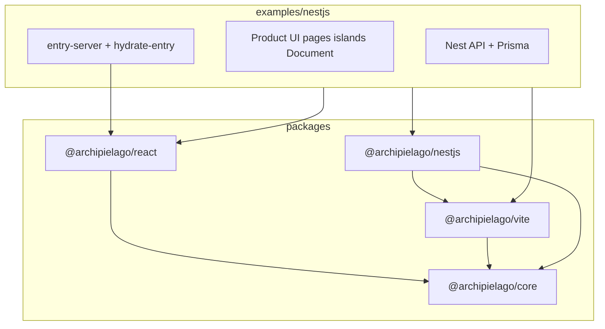

# Phase 2: Archipielago monorepo packages + NestJS example

## Locked decisions

- **Workspace packages only** — no npm publish in this phase. Packages stay installable via `workspace:*`. Roadmap gains an explicit later milestone for first public `0.0.1` publish; every Phase 2 choice must stay publish-friendly (clean `exports`, peers, no app imports into packages, no deep cross-package relative paths).
- **Layout** — framework under `packages/*`; Nest sample moves to [`examples/nestjs`](examples/nestjs).
- **Package IDs** — `@archipielago/core`, `@archipielago/react`, `@archipielago/vite`, `@archipielago/nestjs`.
- **Shared tooling** — one root oxlint / Prettier / Vitest / CI gate; examples bend to the repo (no mini-repos). Host-specific pieces are runtime shape only (Nest modules, DI), not Jest/ESLint forks.
- **Docs** — teach host-agnostic primitives and wiring first; NestJS is an application of those concepts, not the mental model.

## Target shape

| Package                | Source today                                                                                                         | Responsibility                                                                                                                                 |
| ---------------------- | -------------------------------------------------------------------------------------------------------------------- | ---------------------------------------------------------------------------------------------------------------------------------------------- |
| `@archipielago/core`   | [`src/archipielago/core`](src/archipielago/core)                                                                     | `RenderResult`, `PageAssets`, island table contracts, generic `ServerEntry`, path/config shapes (no Nest-sample defaults baked as package law) |
| `@archipielago/react`  | [`src/archipielago/react`](src/archipielago/react)                                                                   | `<Island>`, `renderDocument`, hydrate, props codec; React as **peer**                                                                          |
| `@archipielago/vite`   | [`src/archipielago/host`](src/archipielago/host) + [`src/archipielago/vite`](src/archipielago/vite)                  | Vite plugins, `createDevAssetPipeline`, page-loader / asset delivery; **inject** paths, globs, stylesheet maps from the host                   |
| `@archipielago/nestjs` | thin surface from [`web-view.service.ts`](src/web/web-view.service.ts) + mount helpers from [`main.ts`](src/main.ts) | Nest module / injectable renderer; HTTP+DI outside core                                                                                        |
| `examples/nestjs`      | current Nest app (`src/api`, `src/web`, Prisma, e2e, Storybook)                                                      | Product pages, islands, Document, page-props, Vite app config, `archipielago.config.ts`, island manifest registration                          |

Root becomes a private orchestrator (`archipielago` or similar): pnpm workspace scripts, shared configs, docs. [`pnpm-workspace.yaml`](pnpm-workspace.yaml) gains `packages: ['packages/*', 'examples/*']` (keep `allowBuilds`).

## Publish-ready without publishing

- Each package: `"name"`, `"version": "0.0.0"`, `"private": true`, explicit `"exports"` / `"types"` / `"files"`, correct `peerDependencies` (`react`, `react-dom`, `@nestjs/*` on the Nest package).
- No reverse deps: packages must not import `examples/nestjs` (close [TD-030](docs/known-tech-debt.md) via generic `ServerEntry<TPages>`).
- Prefer `workspace:*` in the example; avoid path aliases that substitute for package boundaries long-term (`@archipielago/*` becomes real package imports).
- Do **not** invent a publish CI or Changesets pipeline yet; roadmap records the future `0.0.1` publish milestone so Phase 3+ does not paint us into a corner.

## Extraction prerequisites (before or as first package cuts)

1. **Genericize** [`server-entry.ts`](src/archipielago/core/server-entry.ts) — drop import of app `SsrPagePropsMap` / `WebPageName`; example supplies the map.
2. **Inject host policy** currently hardcoded in engines:
   - Nest-sample defaults in [`paths.ts`](src/archipielago/core/paths.ts)
   - `import.meta.glob` in [`registry.ts`](src/archipielago/react/runtime/island/registry.ts) → factory or example-owned glob
   - [`page-stylesheets.ts`](src/archipielago/host/asset-delivery/page-stylesheets.ts) page→forms map → example registration
   - Hardcoded `src/web` awareness in Vite shell-budget plugin
3. Keep Nest types out of `core` / `react` / `vite` (already true); Nest package is the only Nest-aware layer.

## Tooling (repo-wide)

- Root owns oxlint, Prettier, Vitest shared config, Commitlint/Husky, CI entrypoints.
- Package/example `package.json` scripts are thin; root runs `pnpm -r` / `--filter` for lint, unit test, build.
- Example-scoped: Nest e2e, browser e2e, Storybook, Prisma — filters to `examples/nestjs`, not every package.
- Extend lint/format globs to `packages/**` and `examples/**`.
- Update [`.oxlintrc.json`](.oxlintrc.json) overrides from `src/archipielago/...` / `src/web/ui` to new paths.
- Dual import zones stay ([ADR-0024](docs/adr/0024-dual-import-resolution.md)): Node-emitted packages use `.js` relatives; Vite/React package uses extensionless where that package’s build graph requires it. Document per-package, not as `src/archipielago/...` paths.
- One Cursor workspace root — no multi-root IDE requirement.

## Documentation (host-agnostic first)

Add under [`docs/archipielago/`](docs/archipielago/) a small guide set (exact filenames can be `guide/*.md`):

1. **Concepts** — ownership split (app vs framework), primitives (`RenderResult`, islands table, `ServerEntry`, asset pipeline, Document injection), how pieces connect. No Nest APIs.
2. **Install** — workspace dependency today; note future `pnpm add @archipielago/...@0.0.1` once published. Peers and which packages a host typically needs.
3. **Wiring** — ordered host-agnostic steps: paths/config → register islands → SSR entry + Document + page map → Vite plugins/pipeline → mount assets in HTTP server → production static. Explicit “host owns X / package owns Y”.
4. **NestJS example** — map each wiring step onto `examples/nestjs` (`@archipielago/nestjs` module, controller → renderer, `main.ts` mount, product UI layout). Cross-links only; do not make Nest the definition of the concepts.

Also update:

- [`docs/archipielago/roadmap.md`](docs/archipielago/roadmap.md) — Phase 2 status/outcomes; add milestone for first npm publish `0.0.1` (after packages exist; prefer after Phase 3 contract proof, not blocking Phase 3 start).
- [`docs/archipielago/README.md`](docs/archipielago/README.md), [`vision.md`](docs/archipielago/vision.md) — monorepo paths.
- [`docs/architecture.md`](docs/architecture.md) — current-state map for packages + example.
- [`docs/how-to-web-ui.md`](docs/how-to-web-ui.md) — authoring against `examples/nestjs` + package imports (or split “author UI in the Nest example” vs framework guide).
- [`AGENTS.md`](AGENTS.md) — import zones and paths for the new layout.

## ADRs (same change set as the structural cut)

- **ADR-0032 (new):** pnpm monorepo layout, package IDs, `packages/*` + `examples/*`, shared tooling ownership, Nest example relocation, publish deferred but export/peer rules. Supersede package-boundary parts of [ADR-0029](docs/adr/0029-archipielago-in-repo-isolation.md) (folder-only isolation).
- Amend or follow-up note on [ADR-0030](docs/adr/0030-archipielago-host-config.md): config/paths live with the example host; package APIs accept injected roots (full host-facing `paths` in config can still wait for Phase 3 second-host friction if injection APIs already unblock the Nest example).
- Update ADR index + architecture links.

## Suggested commit slices (incremental, green checks each)

1. **Docs/ADR lock-in** — ADR-0032 + roadmap publish milestone + plan file under `.cursor/plans/` (per [ADR-0031](docs/adr/0031-project-plan-files.md)).
2. **Decouple** — generic `ServerEntry`, inject stylesheets/glob/paths; tests green in current tree.
3. **`@archipielago/core`** workspace package + root workspace glob; example still in place temporarily via workspace dep or path.
4. **`@archipielago/react`** then **`@archipielago/vite`** (host+plugins).
5. **Relocate** Nest app → `examples/nestjs`; root scripts/CI/filters; remove old `src/archipielago` tree.
6. **`@archipielago/nestjs`** extract adapter; example thins to product + wiring.
7. **Consumer docs** (concepts / install / wiring / nestjs) + architecture / how-to / AGENTS refresh; delete plan file before merge.

## Out of scope (Phase 3+)

- Second host example (Express/Hono), host-facing `paths` in `archipielago.config.ts` if not required by Nest move.
- npm publish, Changesets, public registry CI.
- Repo rename on GitHub / package scope org setup beyond `@archipielago/*` names in workspace.
- Phase 5 docs site dogfooding.
