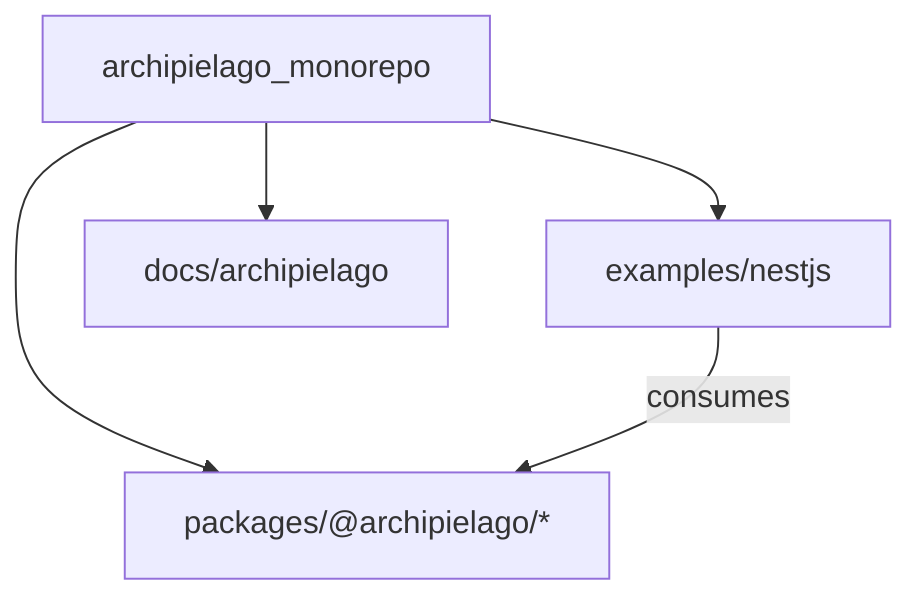

# Docs: Archipielago product-repo framing

## Goal

After Phase 2 ([ADR-0032](docs/adr/0032-archipielago-pnpm-monorepo.md)), the GitHub repo is `archipielago` and the product identity already lives under [`docs/archipielago/`](docs/archipielago/README.md). The root entry docs still present a Nest sample (`# sample-nestjs-project`). Update framing docs so newcomers land on **Archipielago the product**, with `examples/nestjs` as the first host example—not the product itself.

Out of scope: next roadmap phases, code renames (e.g. Docker `sample-nestjs-db`), rewriting historical ADR narrative, or package README files (none exist today).

## Framing rules (apply everywhere we touch)

- **This repository** = Archipielago monorepo (engines in `packages/*`, shared tooling at root, docs source of truth in-tree).
- **`examples/nestjs`** = first runnable NestJS **host example** / reference consumer of `@archipielago/*` (keep calling it example/host, not “the app” or “sample project”).
- Prefer **“Nest example”** over **“Nest sample”** in living docs; leave past-tense ADR history alone.
- Keep practical onboarding (prereqs, DB, run, checks) in the root README—the Nest example remains how you run something locally.

## Branch and plan file

- Branch from `main`: `docs/archipielago-product-repo-framing`
- This plan lives under [`.cursor/plans/`](.cursor/plans/) ([ADR-0031](docs/adr/0031-project-plan-files.md)). Commit it first as the PR starting point; execute the doc edits in later commits; delete the plan in a later commit before merge (CI `plan-files` job).

## File changes

### 1. Rewrite [`README.md`](README.md) (primary)

Replace the Nest-sample title and lead with product identity:

- Title: `# Archipielago`
- Lead: one short definition (embeddable islands SSR for backends that keep routing/auth/data), then monorepo layout (`packages/*` + `examples/nestjs`), Phase 2 done pointer to roadmap/ADR-0032.
- Early links: [`docs/archipielago/README.md`](docs/archipielago/README.md), vision, roadmap, architecture, how-to-web-ui.
- Keep Setup / Database / Run / Checks / Observability / Agents / License, but phrase commands as **running the Nest host example** via root `pnpm` filters (not “the Nest application is this repo”).
- Drop leftover `sample-nestjs-project` naming entirely.

### 2. Present-tense product docs

- [`docs/archipielago/vision.md`](docs/archipielago/vision.md): change “This repo will become the Archipielago monorepo…” to present tense (Phase 2 delivered). Keep long-term items (public site, more hosts) as future.
- [`docs/archipielago/roadmap.md`](docs/archipielago/roadmap.md): in living Phase 2/3 bullets, prefer “Nest example” wording; leave Done status as-is.
- [`docs/archipielago/README.md`](docs/archipielago/README.md): light touch only if any sentence still sounds pre-monorepo (mostly already correct).

### 3. Current-state map framing — [`docs/architecture.md`](docs/architecture.md)

Add a short intro paragraph (do not rewrite the Nest request-split detail): this file maps **today’s Nest host example** plus package layout; host-agnostic product model lives under `docs/archipielago/guide/`. Clarify that API + pages under `examples/nestjs` are the example host’s surfaces, while SSR/islands engines are `@archipielago/*`.

### 4. Root package metadata

Set [`package.json`](package.json) `"description"` to a one-line Archipielago monorepo blurb (currently empty). No other package.json churn.

### 5. Leave alone

- Historical ADRs (0029/0032 “Nest sample” language is historical context).
- [`CONTRIBUTING.md`](CONTRIBUTING.md), [`AGENTS.md`](AGENTS.md) (already monorepo-aware).
- Docker Compose container names / non-doc identifiers.

## Delivery

1. Branch + commit this plan (starting point; no product doc edits yet).
2. Execute the file changes above; run `pnpm format` on touched markdown/json if needed.
3. Commit with [create-commit skill](.agents/skills/create-commit/SKILL.md) (likely one `docs:` commit, or README then product/architecture if split feels cleaner).
4. Delete this plan file in a follow-up commit before merge ([ADR-0031](docs/adr/0031-project-plan-files.md) / CI).

No ADR for this change (framing/docs only; monorepo decision already in ADR-0032).
