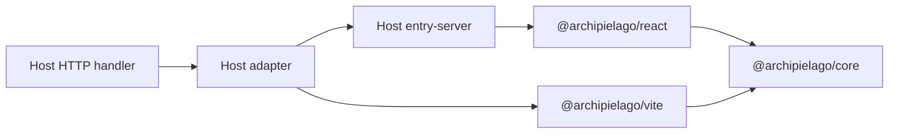

# Concepts

Host-agnostic mental model for Archipielago. NestJS is only one host; see
[wiring.md](./wiring.md) for the ordered integration steps and
[nestjs.md](./nestjs.md) for how the Nest example applies them.

## Ownership split

| Owner                                          | Owns                                                                                                                                                   | Does not own                                               |
| ---------------------------------------------- | ------------------------------------------------------------------------------------------------------------------------------------------------------ | ---------------------------------------------------------- |
| **Host app**                                   | HTTP framework, routing, auth, data, product pages/islands/`Document`, page-prop types, island manifest, stylesheet opt-in maps, Vite app entry config | Core render algorithm, hydrate runtime, asset-tag assembly |
| **`@archipielago/core`**                       | `RenderResult`, `PageAssets`, island table contracts, generic `ServerEntry`, path/config shapes                                                        | Nest/Express types, product page names                     |
| **`@archipielago/react`**                      | `<Island>`, two-pass `renderDocument`, browser hydrate, props codec                                                                                    | Host HTTP, product globs                                   |
| **`@archipielago/vite`**                       | Dev asset pipeline, page loader, manifest → tags, Vite plugins                                                                                         | Framework DI modules                                       |
| **Host adapter** (e.g. `@archipielago/nestjs`) | Thin bridge: injectable renderer, mount helpers                                                                                                        | Product UI                                                 |

## Primitives

### `RenderResult`

Full HTML document (`html`) plus an `assets` bag. The Nest adapter returns
`html` only; other hosts may assemble from `assets` later.

### `ServerEntry<TPages>`

SSR entry contract: `render(page, props, createAssets, csrfToken?)`. `TPages`
is a **host-owned** map of page name → props. Core never imports app page-prop
modules.

### Islands table

`registerIslands(manifest)` injects the name → metadata map engines use.
Hosts maintain the manifest (`auto` sync or `manual`). Engines do not scan
the filesystem at request time.

### Island module glob

Hosts call `setIslandModules(import.meta.glob(...))` from a Vite-owned file
under their product `ui/islands/` tree. Hydrate builds lazy loaders from that
map + the registered names.

### Path roots (`ArchipielagoPaths`)

Where islands, hydrate entry, SSR entry, client out, and shell CSS live.
Defaults match a conventional `src/web/…` host layout when the process cwd is
the host package. Override with `setArchipielagoPaths` when needed.

### Asset pipeline

`createDevAssetPipeline` / `clientAssetsRoot` create Vite middleware or the
production static root. The **host** mounts them on its HTTP server. Opt-in
page stylesheets are registered via `setPageStylesheetRegistry`; pages pass
sheet ids into render.

### Product `Document` + page map

`entry-server` (host-owned) supplies the React page map and document shell,
then calls `renderDocument` from `@archipielago/react`.

## How pieces connect

1. Bootstrap: register islands (+ modules + page stylesheets); mount assets.
2. Request: host builds props → adapter/`ServerEntry.render`.
3. Render: React SSR + asset tags → full document string.
4. Browser: hydrate entry registers islands/modules → selective hydrate.
