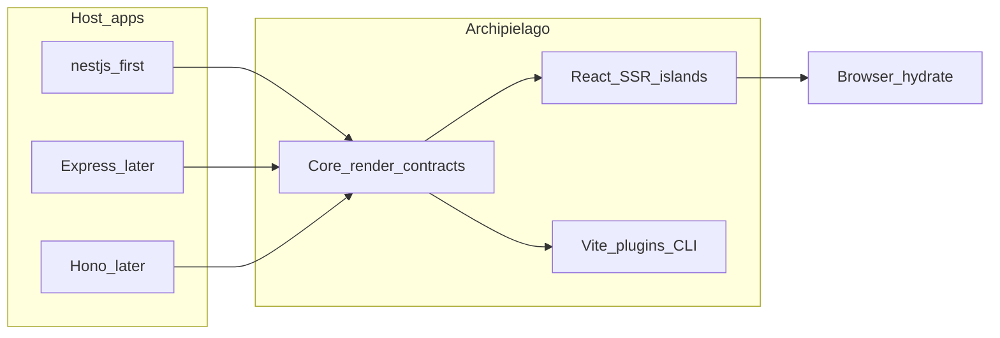

# Archipielago vision

## What it is

Archipielago is **embeddable islands rendering infrastructure** for backends that do **not** monopolize the UI pipeline. The host keeps HTTP, routing, sessions, and business logic. Archipielago supplies React SSR, island discovery, hydration metadata and assets, the browser hydrate runtime, and Vite/build helpers.

NestJS is the first tested host. Later hosts focus on frameworks in the same class—Express, Fastify, Hono, and similar—not on replacing Astro- or Next-style full-stack app frameworks.

## Brand

- **Archipielago** (no accent) is the only Spanish-honoring product name. Kinship and role labels use English.
- Host examples and packages use the framework’s own name (e.g. `nestjs`), not kinship nicknames.

## Market position and kinship

| Project                                        | Role relative to Archipielago                                                                                                                                                                                                                                                                                                                               |
| ---------------------------------------------- | ----------------------------------------------------------------------------------------------------------------------------------------------------------------------------------------------------------------------------------------------------------------------------------------------------------------------------------------------------------- |
| **Astro** (mother)                             | Best-in-class islands _artifacts_ and DX. Learn from it; do not become an Astro competitor that owns the whole app.                                                                                                                                                                                                                                         |
| **is-land** (father / nearest embeddable peer) | Framework-independent hydration coordination. Archipielago aims to be a fuller embeddable stack: SSR + assets + host adapters, not hydrate-only.                                                                                                                                                                                                            |
| **NestJS** (Godfather)                         | Origin ecosystem and design mentor: modularity, dependency injection, testability, and the practical lesson that a serious backend can leave the frontend pipeline open. Tooling habits in this monorepo (pnpm, Vite, oxlint, and related workflow) are ropes the Godfather helped show. Godfather is a **philosophy label**, not a folder or package name. |
| **Inertia**                                    | Embeddable frontend into an owned backend, but not an islands model. Study integration contracts, not hydration strategy.                                                                                                                                                                                                                                   |
| **Fresh / Avalon / Next**                      | Own routing and the presentation pipeline. Outside the target niche.                                                                                                                                                                                                                                                                                        |

Progression: **foundations → parity with parents on our axis → differentiation.** Do not invent “unique” product bets before the field is level.

Godfather is **not** the reason the public site uses NestJS. NestJS earns that role on its own merits (document later). The site’s bold claim is separate: **the Archipielago website is built with Archipielago**.

## Ownership split

| Responsibility                                                       | Owner                |
| -------------------------------------------------------------------- | -------------------- |
| Routing, middleware, auth, authorization, domain data                | Host application     |
| View resolution, React SSR, island discovery                         | Archipielago         |
| Hydration metadata, document asset tags, Vite plugins / sync tooling | Archipielago         |
| HTTP status, cookies, DI modules, `res`/`reply`/`ctx`                | Host adapter         |
| Browser selective hydration                                          | Archipielago runtime |

## Founding design principle: rendering contracts, not HTTP

Archipielago **core** operates on render contracts—conceptually `Renderer` → `RenderResult` (HTML plus island and asset metadata). Core must not depend on NestJS, Express, Fastify, Hono, or raw HTTP request/response types.

- **Host adapters** turn `RenderResult` into framework responses and wire DI or middleware.
- **Asset and Vite delivery** stay inside Archipielago (host engine + Vite helpers). That is document shipping, not a NestJS concern.
- Status codes, cookies, and framework lifecycle stay in the adapter.

This is a **design rule**, not a finished public API. Sketch a thin seam when isolating and extracting; **prove and refine** it when a second host consumes the same pages and islands. Avoid a large port hierarchy before the NestJS package consumer works.

## This repository (monorepo)

This repo will become the **Archipielago monorepo**, not a throwaway demo that loses the framework to a disconnected tree.

Long term it holds:

1. **Framework packages** — core render contracts, React SSR/islands runtime, Vite helpers, host adapters.
2. **Runnable host examples** — named after the framework (`nestjs`, later `express` / `hono`, etc.), not after kinship titles.
3. **Shared tooling** — pnpm workspace, Vite, oxlint, and related gates the Godfather era taught us to keep coherent across packages.
4. **Public site** — documentation and marketing that **runs on Archipielago** (dogfooding). NestJS may host that site; that choice is independent of the Godfather metaphor and can be justified in its own note later.

Today the NestJS app still **embeds** the islands stack under `src/web/`. Isolation and package boundaries come first; the monorepo layout follows (see [roadmap.md](./roadmap.md)).

## Non-goals

- Replacing Astro, Fresh, or Next as an application framework
- Owning app routing or becoming a full-stack meta-framework
- Multi-UI-framework matrices before the React foundations are solid
- Premature interface theater (ports for every future host before one second host exists)
- Spanish kinship or host nicknames beyond the product name Archipielago
