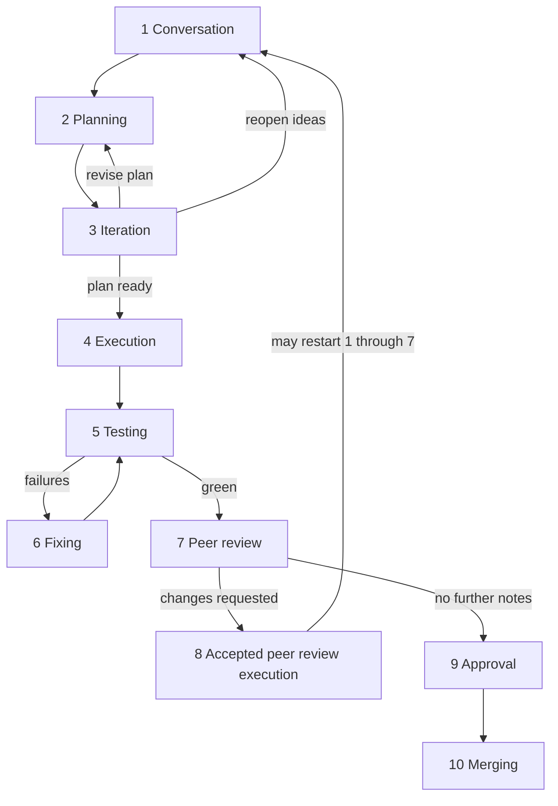

# Recommended AI-assisted workflow

This is the flow we have used from the start of this repository. We are **human-first** and we **encourage AI-assisted development**—agents as accelerators, people as decision-makers. Encouragement is not enforcement: whether someone works **with or without AI** is their decision. The deeper **why** (ADR/tech-debt memory load, think-most / execute-little, compute over crunch) lives in [mission.md](./mission.md). The **sequence** below is a **recommendation**, not a mandate—compress or reorder steps when the change is small or already decided. The **ADR (and related) documentation rules** in the next section are **hard guidelines** for contributions, independent of that flexibility.

It applies to the **whole monorepo**. As the repo becomes Archipielago end to end, this document remains the default contribution rhythm.

When more people join, forum or channel discussion may extend steps 1–3 and 7–9. Keep the shape simple until that scale exists.

## Hard guideline: ADRs and tech debt

A plan that is ready to execute **locks decisions**. Those decisions and the reasoning behind them must be recorded as [Architecture Decision Records](../adr/README.md)—in the same change set as the implementation (or immediately after), not only in chat, a Cursor plan file, or a PR description. Peer review and approval should reject work that locks a durable tradeoff without an ADR (and without updating current-state docs where the ADR policy requires it).

Not every plan or implementation creates tech debt. Trade-offs accepted when locking decisions **often** do. When a deferred cost is known or strongly implied by an accepted tradeoff, document it in [known tech debt](../known-tech-debt.md) (and an `it.fails` spec when the debt is cheaply testable). Identifying that branching debt is **highly encouraged**. It cannot be fully **mandatory** to list every debt an implementation will ever create—unforeseen debt is normal—but leaving _known_ tradeoff debt undocumented is not acceptable once it has been recognized in planning, review, or implementation.

| Artifact                                 | Requirement                                                          |
| ---------------------------------------- | -------------------------------------------------------------------- |
| ADR for locked durable decisions         | **Mandatory**                                                        |
| Known tech debt from accepted trade-offs | **Highly encouraged**; required once the deferred cost is recognized |
| Exhaustive foresight of all future debt  | **Not required** (impossible)                                        |

## Flow

1. **Conversation** — Brainstorm; shape the idea in dialogue (often Ask mode or free chat).
2. **Planning** — Draft a plan and lock decisions that are ready. Desktop Plan mode can draft it in the IDE. For a plan this repo will review, and whenever Plan mode is unavailable, follow [plan-before-code](../../.agents/skills/plan-before-code/SKILL.md) and write `.cursor/plans/` ([ADR-0031](../adr/0031-project-plan-files.md)). Locked durable tradeoffs imply ADR work in execution.
3. **Iteration** — Toggle conversation and planning (Ask + Plan) until the plan is good to go. Surface soft decisions, challenge assumptions, consider alternatives that missed the first pass, and bake results back into the plan. Call out trade-offs that likely spawn tech debt.
4. **Execution** — Implement: write code, create branches, open pull requests, add or update ADRs for locked decisions, and record recognized tech debt (Agent mode or equivalent).
5. **Testing** — Confirm automated and manual checks pass.
6. **Fixing** — If behavior or gates fail expectations, fix here and re-test.
7. **Peer review** — Review the change; suggest improvements; agree what to take.
8. **Accepted peer review execution** — Implement what review accepted. This may walk steps 1–7 again until no further review notes remain.
9. **Approval** — A developer (and, when available, another accountable person) owns approving the final shape of the PR, including ADR coverage for locked decisions and documented known tech debt.
10. **Merging** — Merge the PR into the main branch.

## Tools and environments

We currently develop in **Cursor**. Because Cursor builds on VS Code, much of the same workflow likely already works in **VS Code**; we have not yet invested in documenting or supporting other IDEs.

That is not a hard imposition. Contributors who prefer open-source models, self-hosted AI, or other editors are welcome to use them and to propose work that improves support for additional IDEs and AI-assisted environments—judged by the same objective standards as any other contribution.

## Related

- Operating principles: [mission.md](./mission.md)
- Product intent: [vision.md](./vision.md)
- Phased plan: [roadmap.md](./roadmap.md)
- ADR policy: [docs/adr/README.md](../adr/README.md)
- Tech debt policy: [docs/known-tech-debt.md](../known-tech-debt.md)
