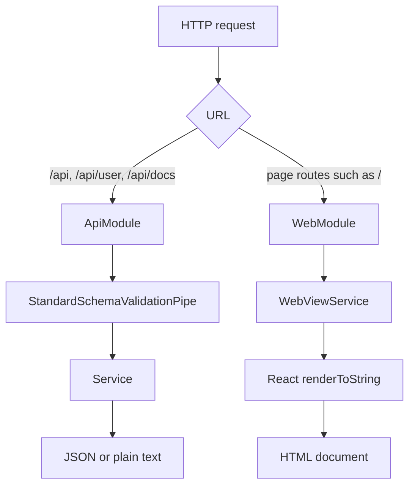
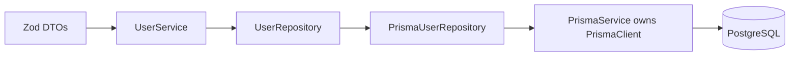
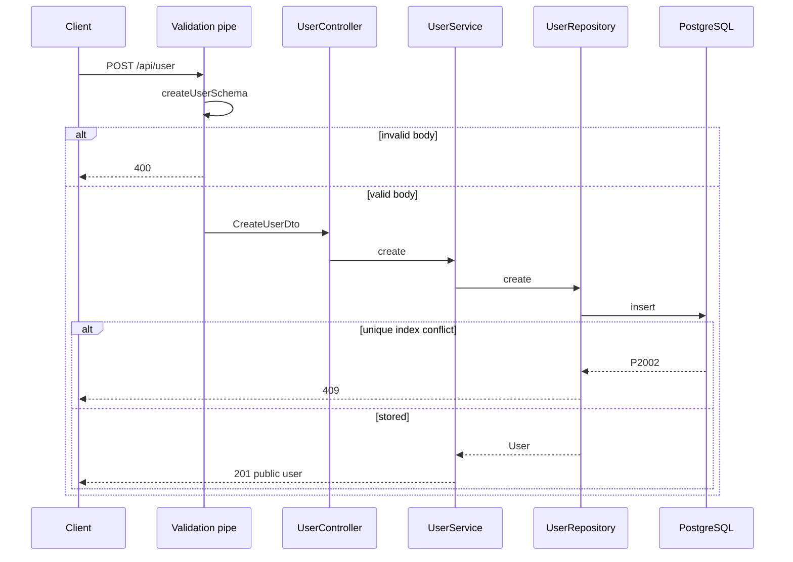
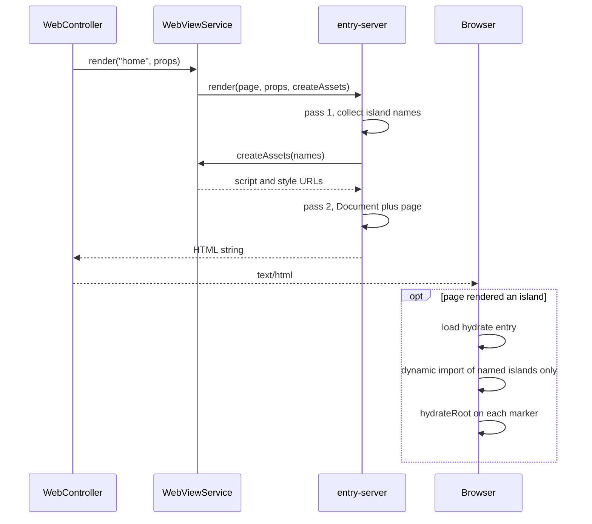
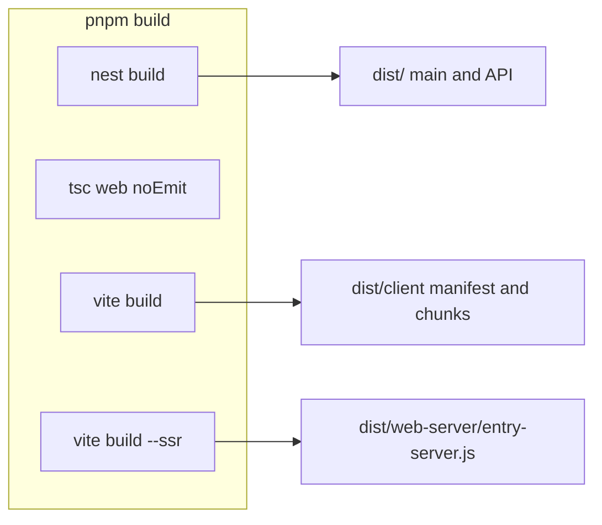

# Architecture

One Nest process serves two surfaces. The JSON API lives under `/api`. HTML pages live at the root. Nest owns routes and data. React owns the HTML: it server-renders the document and hydrates only the islands a page actually rendered.

This is not React Server Components, not a client-side router, and not a string template. A controller picks a page name and a plain props object. It does not import `.tsx`.

## Why this shape

The product goal for the UI is **solid performance**, not “use React everywhere.” The pages that matter next (a CRUD-heavy dashboard) should stay mostly server HTML, with interactivity only where a control needs it. Nest already routes HTTP. Putting a second router in the browser would duplicate that job and push more work onto the client for little gain.

This layout deliberately avoids these common alternatives:

| Alternative                         | Why not here                                                                                                |
| ----------------------------------- | ----------------------------------------------------------------------------------------------------------- |
| Full client SPA (e.g. React Router) | Nest already owns URLs. A client router would re-implement routing and ship a large JS graph by default.    |
| Separate Next.js (or similar) app   | A second deploy, CI pipeline, and host. Extra cost and ops load while the team and traffic are small.       |
| String templates only               | Server pages and interactive widgets would use different syntaxes. React trees stay one language for both.  |
| One React root for the whole page   | Non-interactive markup would still be reconciled on the client. Islands hydrate only the interactive parts. |

**Islands** are the middle path: the same component syntax on the server and in the browser, Nest keeps routing, and Vite ships **only the JS/CSS a page actually used**. Unused island chunks are never downloaded. That download-and-use-only-what-you-need rule is intentional insurance against the usual Core Web Vitals drift from unused JS and CSS—problems that are easy to overlook day to day and expensive to claw back later.

**One Nest process** (API + SSR + static assets) is a hard choice for now: one deploy pipeline, one host, one language, and the same lint/test tools—without a monorepo or parallel CI. That keeps ops and cost down while the team is small. The app can split into separate frontends later if success and headcount justify it; that should be a long way off.

## Request split



| Surface     | Owner           | Examples                                       | Response                                               |
| ----------- | --------------- | ---------------------------------------------- | ------------------------------------------------------ |
| JSON API    | `src/api`       | `GET /api`, `POST /api/user`, `GET /api/docs`  | JSON, or the hello string                              |
| HTML pages  | `src/web`       | `GET /`                                        | `text/html`                                            |
| Dev assets  | Vite middleware | `/@vite/client`, `/src/web/client/hydrate.tsx` | Modules, only when `NODE_ENV` is not `production`      |
| Prod assets | `dist/client`   | `/assets/...`                                  | Built client files, `index: false` so `/` stays a page |

`GET /user` and `GET /docs` are not aliases. They 404. Swagger UI is `/api/docs`. The raw spec is `/api/docs-json`.

Page controllers must not claim `/api`, `/assets`, `/src`, or `/@vite`. Those prefixes belong to the API, the production client build, or the Vite dev server.

`LoggerMiddleware` runs on every route and then calls through.

## Source layout

Folder names do not create URL prefixes. `RouterModule` does.

```text
src/
  main.ts                 bootstrap
  app.module.ts           wires API, web, and the /api prefix
  logger.middleware.ts
  api/                    JSON feature code
    api.module.ts
    app.controller.ts     GET /api
    openapi.setup.ts
    common/               password hashing, Zod to OpenAPI
    user/                 users (controller, service, repository port/adapter)
  persistence/            PrismaModule / PrismaService / PrismaPg helper
  generated/prisma/       Prisma Client output (`prisma generate`; gitignored)
  web/                    HTML and React
    web.controller.ts     page routes
    web-view.service.ts
    page-loader.ts        loads the SSR entry without a static TSX import
    entry-server.tsx      page map and renderToString
    document.tsx
    pages/                server-only page components and their prop types
    islands/              island components, marker, lazy registry
    client/hydrate.tsx    browser entry
```

`tsconfig.build.json` excludes `src/web/**/*.tsx`, so `nest build` never compiles React. The views use `src/web/tsconfig.json` (extends root `tsconfig.web.json`) so the editor’s nearest-config walk finds Vite/`vite/client` types for `*.css` and DOM; TypeScript 6 does not load a root `tsconfig.web.json` by name alone. The repo-root `tsconfig.json` stays on Nest/API `.ts` sources and excludes `src/web/client/**`. `pnpm build` still runs `tsc -p tsconfig.web.json --noEmit`. Vite emits the bundles that actually run.

Prefer `.tsx` where the file is mostly a React tree (pages, islands, document, hydrate entry)—the same places you would reach for HTML. Prefer plain `.ts` for Nest controllers, services, props types, registries, and tests. Specs stay `.ts` and use `createElement` when they need elements; JSX is not required to exercise an island. Because `createElement` does not infer a generic `Island<P>` as well as JSX does, a test may pass an explicit type argument (for example `Island<{ start: number }>`) so `component` and `props` still typecheck.

## JSON API

### Routing

`AppModule` registers the prefix on the module that owns the controllers:

```ts
RouterModule.register([
  {
    path: 'api',
    module: ApiModule,
    children: [{ path: '/', module: UserModule }],
  },
]);
```

`RouterModule` sets the path on that module, not on modules it merely imports. `UserModule` is listed as a child so `@Controller('user')` becomes `/api/user`. `AppController` sits on `ApiModule`, so its `@Controller()` route is `GET /api`.

E2E boots `AppModule` and never runs `src/main.ts`. The prefix has to live in the module graph, not in `app.setGlobalPrefix`. A test that imports `UserModule` alone will not see `/api`.

`WebModule` is imported with no path, so page routes stay at the root.

### Zod and the validation pipe

`main.ts` installs `StandardSchemaValidationPipe` globally. Controllers pass the Zod schema on the parameter decorator. The pipe validates and transforms the value before the handler runs. A failure is HTTP 400.

```ts
@Body({ schema: createUserSchema }) createUserDto: CreateUserDto
@Param('id', { schema: userIdSchema }) id: string
```

Schemas are the source of the TypeScript types (`z.infer`). Current contracts:

| Schema               | Rules                                                                                                                                                                                              |
| -------------------- | -------------------------------------------------------------------------------------------------------------------------------------------------------------------------------------------------- |
| `createUserSchema`   | Strict object: email, username, display name, password of at least 8 characters. Unknown keys are rejected. Usernames are trimmed, a leading `@` is stripped, then checked for length and pattern. |
| `updateUserSchema`   | Create schema without email and username, every remaining field optional, still strict, and at least one of `displayName` or `password` is required.                                               |
| `userIdSchema`       | UUID path parameter.                                                                                                                                                                               |
| `userResponseSchema` | Public user: `id`, `email`, `username`, `displayName`, `verified`. No password.                                                                                                                    |

### Users, passwords, and responses

`UserService` builds domain `User` values (UUID, Argon2id hash, field-by-field from the DTO) and persists them through a **repository port** (`USER_REPOSITORY` / `UserRepository`). The Prisma adapter (`PrismaUserRepository`) is the only place that imports the generated Prisma Client. Controllers and the service never depend on Prisma types. Feature mapping lives in `user.mapper.ts`: persistence row → domain (`toDomainUser`) and domain → public DTO (`toUserResponseDto`).

Email and username uniqueness is enforced by Postgres expression unique indexes on `LOWER(email)` and `LOWER(username)` (see `prisma/migrations`). Both are case-insensitive so one mailbox maps to one account and usernames stay unique while preserving typed casing (Twitter-style). Prisma schema cannot express expression indexes, so those constraints live in SQL migrations rather than `@@unique`. Unique violations surface as Prisma `P2002` and become HTTP 409 in the adapter.

`hashPassword` uses Argon2id. The encoded string carries the algorithm, cost parameters, salt, and hash so verification can rebuild the same derivation. Cost parameters are constants in `src/api/common/password.ts` (see TD-005). The Prisma seed imports the same helper so hashing does not drift.

`toUserResponseDto` returns an allowlisted object. The password hash is not part of that object. There is no response interceptor that filters bodies at the edge yet (see TD-007).

Delete returns 204 whether or not the id existed. That is the contract, not debt.

Writes are not authenticated yet (see TD-001).

### Persistence

PostgreSQL is the system of record. **Prisma 7** owns the **database** schema (`prisma/schema.prisma` + migrations) and CLI config (`prisma.config.ts`). The app talks to Postgres through `@prisma/adapter-pg`. Zod owns the **HTTP** contracts. Domain `User` in `src/api/user/entities/user.entity.ts` is the port type between them. `PrismaService` **composes** `PrismaClient` (owns a `client` field) rather than extending it, so Nest DI wraps the vendor client instead of merging the two types. Formal Architecture Decision Records are deferred (TD-011); this section is the current decision record. Global Prisma module init always `$connect`s for the process lifetime even when a request never touches the DB (see TD-012).

`prisma generate` writes the Prisma Client to `src/generated/prisma` (gitignored; regenerated on install/build). That folder is **not** migrations — SQL history lives in `prisma/migrations/` and is applied with `prisma migrate deploy`.



| Concern         | How                                                                                                                             |
| --------------- | ------------------------------------------------------------------------------------------------------------------------------- |
| Local manual DB | Docker Compose (`docker-compose.yml`) + GNU Make (`make db-up`, `make db-migrate`, `make db-seed`)                              |
| App connection  | `DATABASE_URL` in `.env` / `prisma.config.ts` (see `.env.example`); required for migrate/seed/runtime, not for generate alone   |
| Nest wiring     | Global `PrismaModule` / `PrismaService` (composes `PrismaClient` + PrismaPg); `UserModule` factory-binds the repository adapter |
| E2E database    | Testcontainers Postgres (not Compose); migrate deploy once per run; truncate between tests                                      |
| Client codegen  | `prisma generate` → `src/generated/prisma` on `postinstall` and at the start of `pnpm build` (works without a live DB / `.env`) |

### OpenAPI

`setupOpenApi` runs after the global pipe so the documented routes match runtime validation. `SwaggerModule.setup('api/docs', ...)` serves the UI. Nest exposes the raw document at `/api/docs-json`. The document is built on first request.

Response schemas are generated from Zod, using the output shape:

```ts
z.toJSONSchema(schema, { target: 'openapi-3.0', io: 'output' });
```

Controllers attach those objects with `@ApiOkResponse`, `@ApiCreatedResponse`, and the error decorators. `WebController` is marked `@ApiExcludeController()`, so HTML routes stay out of the spec.

Swagger is served in every environment today (see TD-006).



## Web pages

### Roles

| Piece                | Responsibility                                                    |
| -------------------- | ----------------------------------------------------------------- |
| `WebController`      | Chooses the page name and builds JSON props. Sets `text/html`.    |
| `WebViewService`     | Loads the server entry and asks it to render.                     |
| `entry-server.tsx`   | Maps the page name to a React component and renders the document. |
| Page component       | Server-only body. May place islands in the tree.                  |
| `Island`             | Server-renders the component and writes the hydration marker.     |
| `client/hydrate.tsx` | Browser entry. Hydrates markers and nothing else.                 |

Props types live in `.ts` files (`home-page.props.ts`). The controller imports those types, not the component.

`loadServerEntry` builds the module specifier at runtime:

- Development: `vite.ssrLoadModule('/src/web/entry-server.tsx')`.
- Tests: a dynamic import of `entry-server.tsx` next to the loader, so Vitest transforms it.
- Production: `dist/web-server/entry-server.js`.

A static `import './entry-server.tsx'` would pull React into the Nest compile.

### Server render

Rendering is two passes of `renderToString`. Streaming SSR is not the contract.



Pass 1 renders the page inside `IslandNamesContext`. Each `Island` adds its name to that set. Pass 2 renders `Document` around the same page. The context is null on pass 2, so the second render still emits the marker and the server HTML, and it does not change the asset list.

`createAssets([])` returns the shared stylesheet and no scripts. A page with no islands does not download the hydrate entry.

The home page keeps its sentence in one template string. Adjacent text expressions would become HTML comments, and the sentence would not match as a single string.

### Islands

An island is a client component with its own React root. The server page places it with the `Island` helper. That helper is generic over props (`Island<P>`): `component` is a `ComponentType<P>` and `props` is `P`, so any island (counter today, others later) keeps those two in sync. There is no single React “Props” type beyond that—`PropsWithChildren` and friends are helpers around a per-component shape, not a substitute for `P`.

The server marker is:

```html
<div data-island="counter" data-props="...">
  <button type="button">Count: 0</button>
</div>
```

`data-props` is `encodeURIComponent(JSON.stringify(props))`, so quotes and `<` cannot break the attribute. The decoder rejects arrays, null, and non-objects. Props must be JSON-serializable plain objects. Richer prop graphs (functions, class instances, non-JSON values) are out of scope until the dashboard needs them; CRUD pages do not.

`hydrateRoot` is called on the marker element. React hydrates the component as that element's children. The marker div is the container, not part of the component tree.

Islands do not share React context or state after hydration. Each marker is its own root (see TD-008). A shared client context layer would take real design work; the expected dashboard is CRUD-oriented and is not planning websockets or other real-time client graphs soon, so that stays deferred debt rather than part of the current contract.

### Lazy chunks

The client entry imports the registry, not the island components:

```ts
export const islandLoaders = {
  counter: loadCounterIsland,
} as const;

function loadCounterIsland() {
  return import('./counter.js');
}
```

Vite emits a separate chunk per dynamic `import()`. The browser does not download that chunk until `import()` runs. A page that never renders `counter` never requests `counter-*.js`.

`assetTagsFromManifest` emits the hydrate entry and its static `imports` (React, for example). It does not walk `dynamicImports`, and it does not emit modulepreload links for them. Preloading those keys would fetch every island. Island CSS imported by a chunk is left on that chunk.

Vite still injects `<link rel="modulepreload">` at runtime when a dynamic `import()` runs. That helper lives in the hydrate bundle (`__vitePreload`); Nest's document shell never writes those tags. For islands already on the page that is usually a win: the chunk and its CSS start fetching just before the import resolves. It does not preload islands the page never imports.

That default should be revisited if we ship TD-010 (viewport or streaming hydration). Eager `modulepreload` for every island the entry is about to hydrate would fight delaying those downloads until near the viewport. The same applies if Core Web Vitals (or similar) start flagging excess preload. The switch is Vite's `build.modulePreload: false` on the client build in `vite.config.ts`. Leave the default on until one of those triggers.

The registry's `isIslandName` check uses `hasOwnProperty`, so a marker named `toString` is unknown. An unknown name throws before hydration.

The home page includes a counter island so hydration can be clicked. It is a demo. Remove the component, its CSS module, the registry entry, and the `<Island name="counter">` together (see TD-009). Nothing else should depend on it.

### Styles

Two kinds of CSS, chosen while authoring. There is no post-hoc critical-CSS extract or PurgeCSS pass: unused Bootstrap is removed later by handpicking SCSS imports (a priori), not by scanning templates.

`src/web/styles.scss` is the shared shell sheet (today a full Bootstrap import; handpick reset, grid, type, and colors later). It is its own Vite client input, not an import of `client/hydrate.tsx`. The document emits one `<link>` because this app writes its own HTML and Vite will not inject it. In development the href is `/src/web/styles.scss` and `/@vite/client` is always loaded so SCSS edits reload without BrowserSync. In production the href comes from the client manifest. Compilation is Sass → PostCSS (`postcss-sort-media-queries` + doiuse warn-only) → Lightning CSS minify at **Baseline Widely Available**. A Vite plugin **reports** raw and gzip shell size against a configurable budget (`SHELL_CSS_BUDGET_BYTES`, default 50 KiB gzip) and never fails the build. Keep the sheet toward that budget once Bootstrap is handpicked; those bytes are render-blocking on purpose for first paint. Inlining the shell (and colocating island CSS as `<style>` next to island markup) is TD-017 (Part II).

An island that needs its own rules imports a CSS module next to the component. Prefer `*.module.scss` when variables or nesting help; plain `*.module.css` remains valid. Islands may `@import` / `@use` `src/web/styles/_tokens.scss` (Bootstrap functions, variables, maps, mixins only—no CSS output). They must **not** import `styles.scss` or Bootstrap CSS-emitting partials already in the shell (duplicate rules). Warning when that happens is TD-016. Vite attaches the module to the island chunk and applies it when the dynamic `import()` runs, after the document has painted. Those URLs are not copied into `<head>`.

A late island rule can still move a box that is already on screen. That matters when the shift is in the viewport (CLS), not merely because the rule arrived late. Put a rule in the shared sheet when the server HTML would shift without it, or when the element is page chrome. Examples: body type and spacing, a fixed navbar, the box size of an above-the-fold control. Leave color, hover, and other decoration in the module. Do not ban above-the-fold islands. If one of them needs layout before paint, move those rules into the shell instead of linking every island stylesheet (until TD-017 inlines island CSS beside the markup).

A server-only page component does not publish CSS by being rendered. Styles the browser must see are in the shared sheet or imported by a client module.

Hydrating every island as soon as the entry loads, including ones below the fold, downloads their JS and CSS before the user scrolls (and Vite's runtime `modulepreload` for those dynamic imports runs at the same time). Delaying that until the marker is near the viewport, or streaming those islands, is TD-010. When that work lands, turn off `build.modulePreload` so the preload helper does not undo the delay. It is more optimization than this app needs while the only client component is the demo counter. It does not replace the shell link or the rule about which styles belong there.

### Development and production

|                                          | Development                                                                                                              | Production                                                       |
| ---------------------------------------- | ------------------------------------------------------------------------------------------------------------------------ | ---------------------------------------------------------------- |
| How it starts                            | `pnpm start` / `start:dev`                                                                                               | `NODE_ENV=production` via `pnpm start:prod`                      |
| SSR                                      | Vite middleware mode, `ssrLoadModule`                                                                                    | `dist/web-server/entry-server.js`                                |
| Client scripts when an island is present | `/@id/@vitejs/plugin-react/preamble`, `/@vite/client`, `/src/web/client/hydrate.tsx`                                     | Manifest entry and its static imports, under `/`                 |
| Styles                                   | Shell `<link href="/src/web/styles.scss">` plus `/@vite/client` even without islands. Island CSS arrives with its chunk. | Shell `<link>` from the manifest. Island CSS stays on its chunk. |
| Static files                             | Vite serves source                                                                                                       | `express.static` on `dist/client`, with `index: false`           |

The React refresh preamble is required in development because this app writes its own HTML. Vite would inject that preamble into an `index.html`; it does not see ours. Without `window.$RefreshReg$`, an island module throws before `hydrateRoot` runs. Production builds do not include the refresh runtime.

`pnpm build` runs four steps: `nest build`, `tsc -p tsconfig.web.json --noEmit`, `vite build` (client manifest and chunks), and `vite build --ssr` (the Node render bundle). `emptyOutDir` is false on both Vite builds so they can share `dist/`.



## Adding a page

1. Add a props type in `src/web/pages`, as a `.ts` file.
2. Add the page component and register it in the `pages` map in `entry-server.tsx`.
3. Add a `WebController` method that builds props and calls `webViewService.render(name, props)`.
4. Keep the route off `/api` and the asset prefixes above.
5. Leave `@ApiExcludeController()` on the controller.

If the page renders no islands, do not add a script tag by hand. The empty asset list is the signal.

## Adding an island

1. Add a component under `src/web/islands` with a default export and JSON-serializable props. Import a CSS module (`*.module.scss` preferred) beside it for rules that should download only with that island. Use `styles/_tokens.scss` for Sass variables/mixins; never re-import the shell sheet. Put layout that must be present on first paint in `src/web/styles.scss`.
2. Add a `() => import('./that-file.js')` entry to `islandLoaders`. Do not statically import the component from `client/hydrate.tsx` or from another island's module graph if it should stay in its own chunk.
3. Render `<Island name="..." component={...} props={...} />` from a server page.
4. The server may import the component. That import stays in the SSR bundle, which is not sent to the browser.

## Related docs

- [Testing and coverage](./testing-and-coverage.md) — `.tsx` is outside unit coverage; HTTP behavior is covered by e2e.
- [Known tech debt](./known-tech-debt.md) — TD-001 and TD-005 through TD-010 are the open limits of this design. Shared island client state is TD-008; the demo counter is TD-009. Below-the-fold islands still hydrate with the entry (TD-010). JSON-only island props and no shared client context are current limits of the same web layer, deferred until the dashboard needs more than CRUD.
