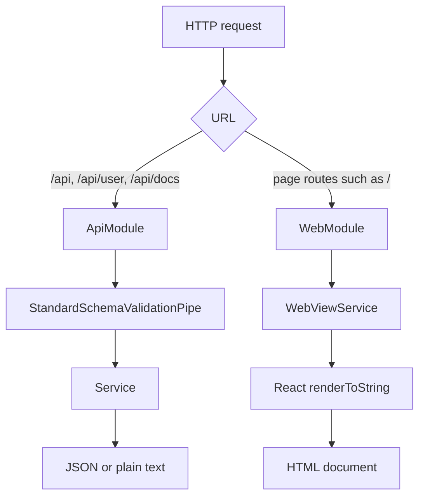
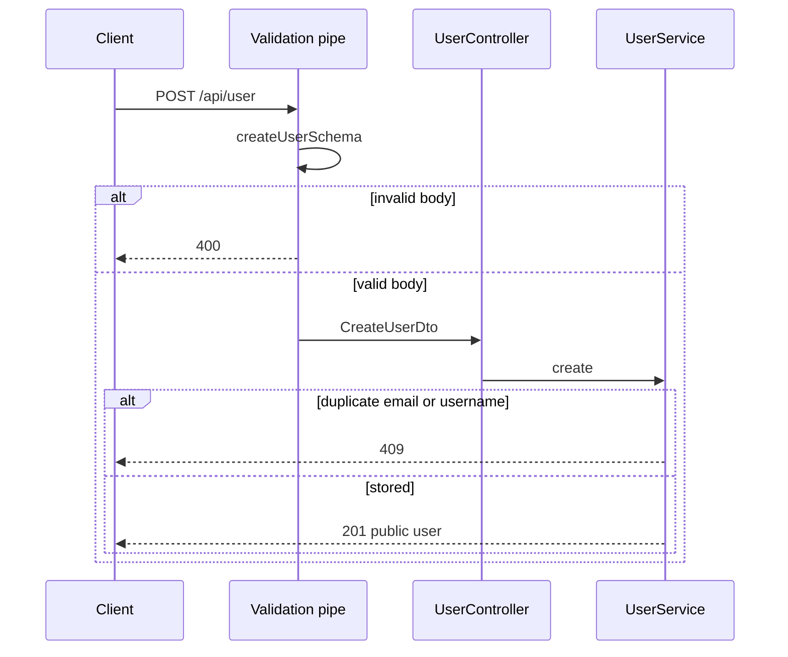
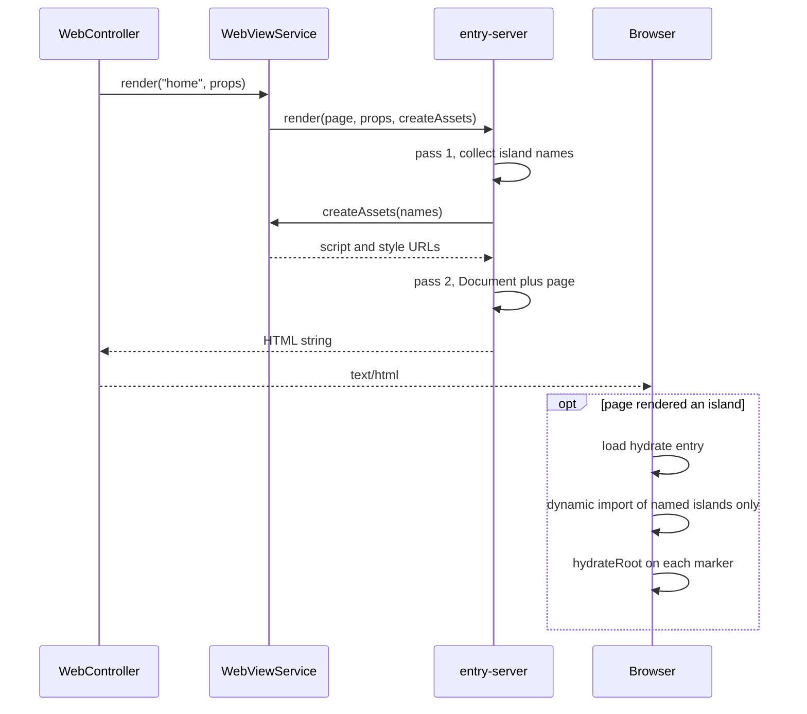
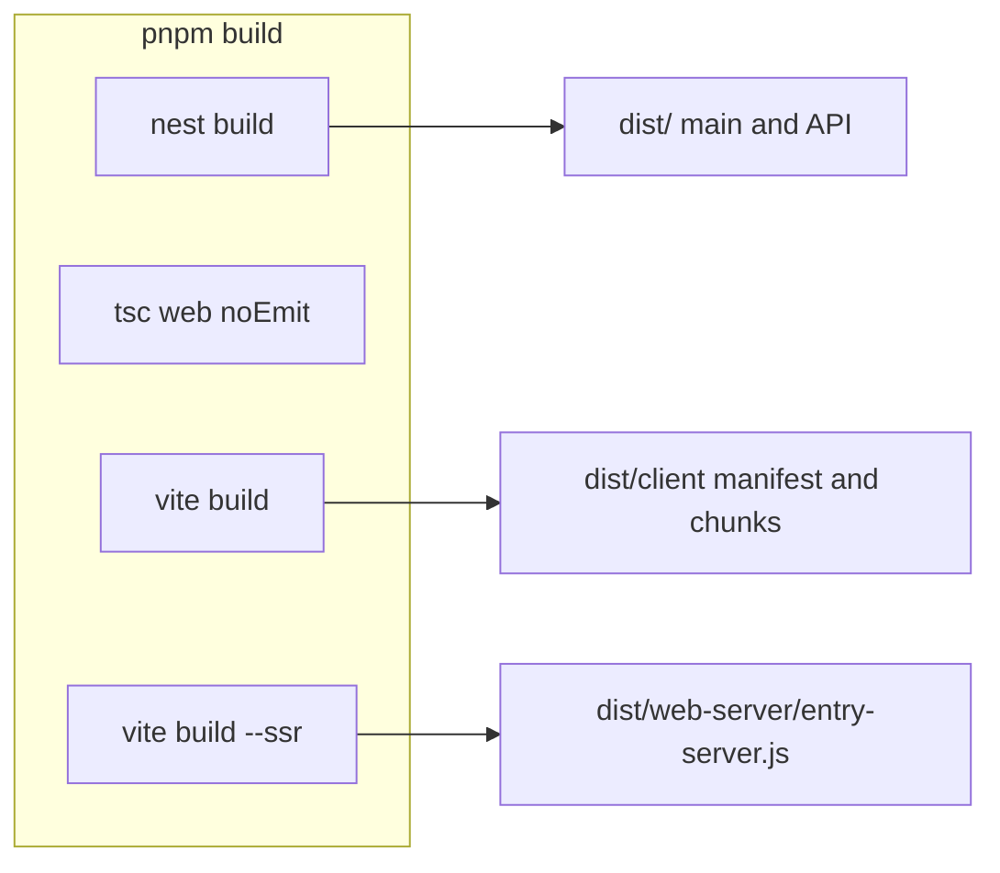

# Architecture

One Nest process serves two surfaces. The JSON API lives under `/api`. HTML pages live at the root. Nest owns routes and data. React owns the HTML: it server-renders the document and hydrates only the islands a page actually rendered.

This is not React Server Components, not a client-side router, and not a string template. A controller picks a page name and a plain props object. It does not import `.tsx`.

## Request split



| Surface     | Owner           | Examples                                       | Response                                               |
| ----------- | --------------- | ---------------------------------------------- | ------------------------------------------------------ |
| JSON API    | `src/api`       | `GET /api`, `POST /api/user`, `GET /api/docs`  | JSON, or the hello string                              |
| HTML pages  | `src/web`       | `GET /`                                        | `text/html`                                            |
| Dev assets  | Vite middleware | `/@vite/client`, `/src/web/client/hydrate.tsx` | Modules, only when `NODE_ENV` is not `production`      |
| Prod assets | `dist/client`   | `/assets/...`                                  | Built client files, `index: false` so `/` stays a page |

`GET /user` and `GET /docs` are not aliases. They 404. Swagger UI is `/api/docs`. The raw spec is `/api/docs-json`.

Page controllers must not claim `/api`, `/assets`, `/src`, or `/@vite`. Those prefixes belong to the API, the production client build, or the Vite dev server.

`LoggerMiddleware` runs on every route and then calls through.

## Source layout

Folder names do not create URL prefixes. `RouterModule` does.

```text
src/
  main.ts                 bootstrap
  app.module.ts           wires API, web, and the /api prefix
  logger.middleware.ts
  api/                    JSON feature code
    api.module.ts
    app.controller.ts     GET /api
    openapi.setup.ts
    common/               password hashing, Zod to OpenAPI
    user/                 users
  web/                    HTML and React
    web.controller.ts     page routes
    web-view.service.ts
    page-loader.ts        loads the SSR entry without a static TSX import
    entry-server.tsx      page map and renderToString
    document.tsx
    pages/                server-only page components and their prop types
    islands/              island components, marker, lazy registry
    client/hydrate.tsx    browser entry
```

`tsconfig.build.json` excludes `src/web/**/*.tsx`, so `nest build` never compiles React. `tsconfig.web.json` is the sole TypeScript project for the views (including the Vite client entry and `*.css` imports via `vite/client`); the root `tsconfig.json` stays on Nest/API `.ts` sources and excludes `src/web/client/**` so the language service does not typecheck hydrate under Node-only ambient types. Vite emits the bundles that actually run.

## JSON API

### Routing

`AppModule` registers the prefix on the module that owns the controllers:

```ts
RouterModule.register([
  {
    path: 'api',
    module: ApiModule,
    children: [{ path: '/', module: UserModule }],
  },
]);
```

`RouterModule` sets the path on that module, not on modules it merely imports. `UserModule` is listed as a child so `@Controller('user')` becomes `/api/user`. `AppController` sits on `ApiModule`, so its `@Controller()` route is `GET /api`.

E2E boots `AppModule` and never runs `src/main.ts`. The prefix has to live in the module graph, not in `app.setGlobalPrefix`. A test that imports `UserModule` alone will not see `/api`.

`WebModule` is imported with no path, so page routes stay at the root.

### Zod and the validation pipe

`main.ts` installs `StandardSchemaValidationPipe` globally. Controllers pass the Zod schema on the parameter decorator. The pipe validates and transforms the value before the handler runs. A failure is HTTP 400.

```ts
@Body({ schema: createUserSchema }) createUserDto: CreateUserDto
@Param('id', { schema: userIdSchema }) id: string
```

Schemas are the source of the TypeScript types (`z.infer`). Current contracts:

| Schema               | Rules                                                                                                                                                                                              |
| -------------------- | -------------------------------------------------------------------------------------------------------------------------------------------------------------------------------------------------- |
| `createUserSchema`   | Strict object: email, username, display name, password of at least 8 characters. Unknown keys are rejected. Usernames are trimmed, a leading `@` is stripped, then checked for length and pattern. |
| `updateUserSchema`   | Create schema without email and username, every remaining field optional, still strict, and at least one of `displayName` or `password` is required.                                               |
| `userIdSchema`       | UUID path parameter.                                                                                                                                                                               |
| `userResponseSchema` | Public user: `id`, `email`, `username`, `displayName`, `verified`. No password.                                                                                                                    |

### Users, passwords, and responses

`UserService` stores users in an in-memory `Map`. Create generates a UUID, hashes the password, and rejects a duplicate email or username (case-insensitive) with HTTP 409. The stored document is built field by field so extra DTO properties are not copied in.

`hashPassword` uses Argon2id. The encoded string carries the algorithm, cost parameters, salt, and hash so verification can rebuild the same derivation. Cost parameters are constants in `src/api/common/password.ts` (see TD-005).

`toUserResponseDto` returns an allowlisted object. The password hash is not part of that object. There is no response interceptor that filters bodies at the edge yet (see TD-007).

Delete returns 204 whether or not the id existed. That is the contract, not debt.

Writes are not authenticated yet (see TD-001).

### OpenAPI

`setupOpenApi` runs after the global pipe so the documented routes match runtime validation. `SwaggerModule.setup('api/docs', ...)` serves the UI. Nest exposes the raw document at `/api/docs-json`. The document is built on first request.

Response schemas are generated from Zod, using the output shape:

```ts
z.toJSONSchema(schema, { target: 'openapi-3.0', io: 'output' });
```

Controllers attach those objects with `@ApiOkResponse`, `@ApiCreatedResponse`, and the error decorators. `WebController` is marked `@ApiExcludeController()`, so HTML routes stay out of the spec.

Swagger is served in every environment today (see TD-006).



## Web pages

### Roles

| Piece                | Responsibility                                                    |
| -------------------- | ----------------------------------------------------------------- |
| `WebController`      | Chooses the page name and builds JSON props. Sets `text/html`.    |
| `WebViewService`     | Loads the server entry and asks it to render.                     |
| `entry-server.tsx`   | Maps the page name to a React component and renders the document. |
| Page component       | Server-only body. May place islands in the tree.                  |
| `Island`             | Server-renders the component and writes the hydration marker.     |
| `client/hydrate.tsx` | Browser entry. Hydrates markers and nothing else.                 |

Props types live in `.ts` files (`home-page.props.ts`). The controller imports those types, not the component.

`loadServerEntry` builds the module specifier at runtime:

- Development: `vite.ssrLoadModule('/src/web/entry-server.tsx')`.
- Tests: a dynamic import of `entry-server.tsx` next to the loader, so Vitest transforms it.
- Production: `dist/web-server/entry-server.js`.

A static `import './entry-server.tsx'` would pull React into the Nest compile.

### Server render

Rendering is two passes of `renderToString`. Streaming SSR is not the contract.



Pass 1 renders the page inside `IslandNamesContext`. Each `Island` adds its name to that set. Pass 2 renders `Document` around the same page. The context is null on pass 2, so the second render still emits the marker and the server HTML, and it does not change the asset list.

`createAssets([])` returns no stylesheets and no scripts. A page with no islands is server HTML only. The browser does not download the hydrate entry.

The home page keeps its sentence in one template string. Adjacent text expressions would become HTML comments, and the sentence would not match as a single string.

### Islands

An island is a client component with its own React root. The server marker is:

```html
<div data-island="counter" data-props="...">
  <button type="button">Count: 0</button>
</div>
```

`data-props` is `encodeURIComponent(JSON.stringify(props))`, so quotes and `<` cannot break the attribute. The decoder rejects arrays, null, and non-objects.

`hydrateRoot` is called on the marker element. React hydrates the component as that element's children. The marker div is the container, not part of the component tree.

Islands do not share React context or state after hydration. Each marker is its own root (see TD-008).

### Lazy chunks

The client entry imports the registry, not the island components:

```ts
export const islandLoaders = {
  counter: loadCounterIsland,
} as const;

function loadCounterIsland() {
  return import('./counter.js');
}
```

Vite emits a separate chunk per dynamic `import()`. The browser does not download that chunk until `import()` runs. A page that never renders `counter` never requests `counter-*.js`.

`assetTagsFromManifest` emits the hydrate entry, its CSS, and its static `imports` (React, for example). It does not walk `dynamicImports`, and it does not emit modulepreload links for them. Preloading those keys would fetch every island.

The registry's `isIslandName` check uses `hasOwnProperty`, so a marker named `toString` is unknown. An unknown name throws before hydration.

The home page includes a counter island so hydration can be clicked. It is a demo. Remove the component, the registry entry, and the `<Island name="counter">` together (see TD-009). Nothing else should depend on it.

### Development and production

|                                          | Development                                                                          | Production                                             |
| ---------------------------------------- | ------------------------------------------------------------------------------------ | ------------------------------------------------------ |
| How it starts                            | `pnpm start` / `start:dev`                                                           | `NODE_ENV=production` via `pnpm start:prod`            |
| SSR                                      | Vite middleware mode, `ssrLoadModule`                                                | `dist/web-server/entry-server.js`                      |
| Client scripts when an island is present | `/@id/@vitejs/plugin-react/preamble`, `/@vite/client`, `/src/web/client/hydrate.tsx` | Manifest entry and its static imports, under `/`       |
| Styles                                   | Vite injects CSS                                                                     | `<link>` tags from the manifest                        |
| Static files                             | Vite serves source                                                                   | `express.static` on `dist/client`, with `index: false` |

The React refresh preamble is required in development because this app writes its own HTML. Vite would inject that preamble into an `index.html`; it does not see ours. Without `window.$RefreshReg$`, an island module throws before `hydrateRoot` runs. Production builds do not include the refresh runtime.

`pnpm build` runs four steps: `nest build`, `tsc -p tsconfig.web.json --noEmit`, `vite build` (client manifest and chunks), and `vite build --ssr` (the Node render bundle). `emptyOutDir` is false on both Vite builds so they can share `dist/`.



## Adding a page

1. Add a props type in `src/web/pages`, as a `.ts` file.
2. Add the page component and register it in the `pages` map in `entry-server.tsx`.
3. Add a `WebController` method that builds props and calls `webViewService.render(name, props)`.
4. Keep the route off `/api` and the asset prefixes above.
5. Leave `@ApiExcludeController()` on the controller.

If the page renders no islands, do not add a script tag by hand. The empty asset list is the signal.

## Adding an island

1. Add a component under `src/web/islands` with a default export and JSON-serializable props.
2. Add a `() => import('./that-file.js')` entry to `islandLoaders`. Do not statically import the component from `client/hydrate.tsx` or from another island's module graph if it should stay in its own chunk.
3. Render `<Island name="..." component={...} props={...} />` from a server page.
4. The server may import the component. That import stays in the SSR bundle, which is not sent to the browser.

## Related docs

- [Testing and coverage](./testing-and-coverage.md) — `.tsx` is outside unit coverage; HTTP behavior is covered by e2e.
- [Known tech debt](./known-tech-debt.md) — TD-001 and TD-005 through TD-009 are the open limits of this design.
