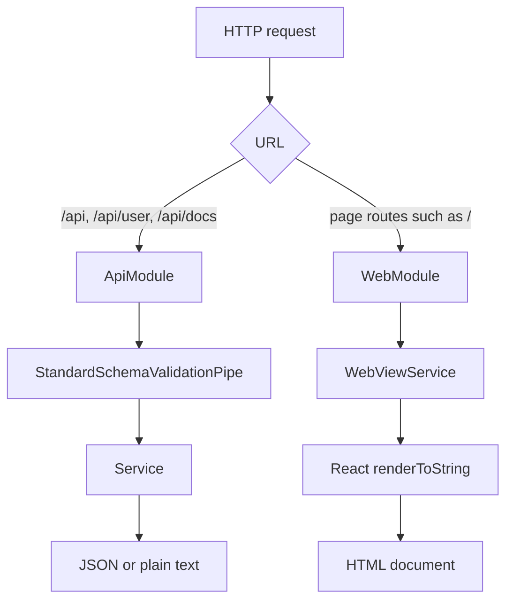
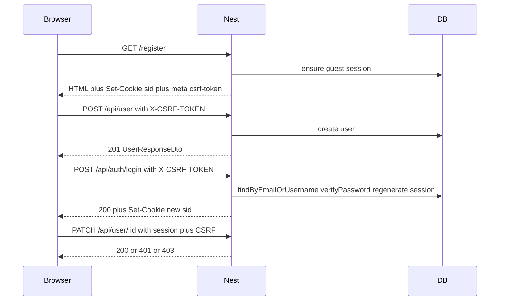
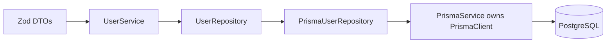
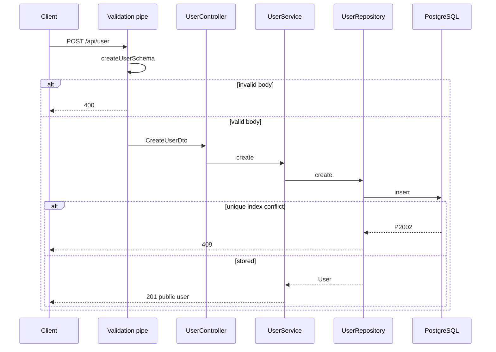
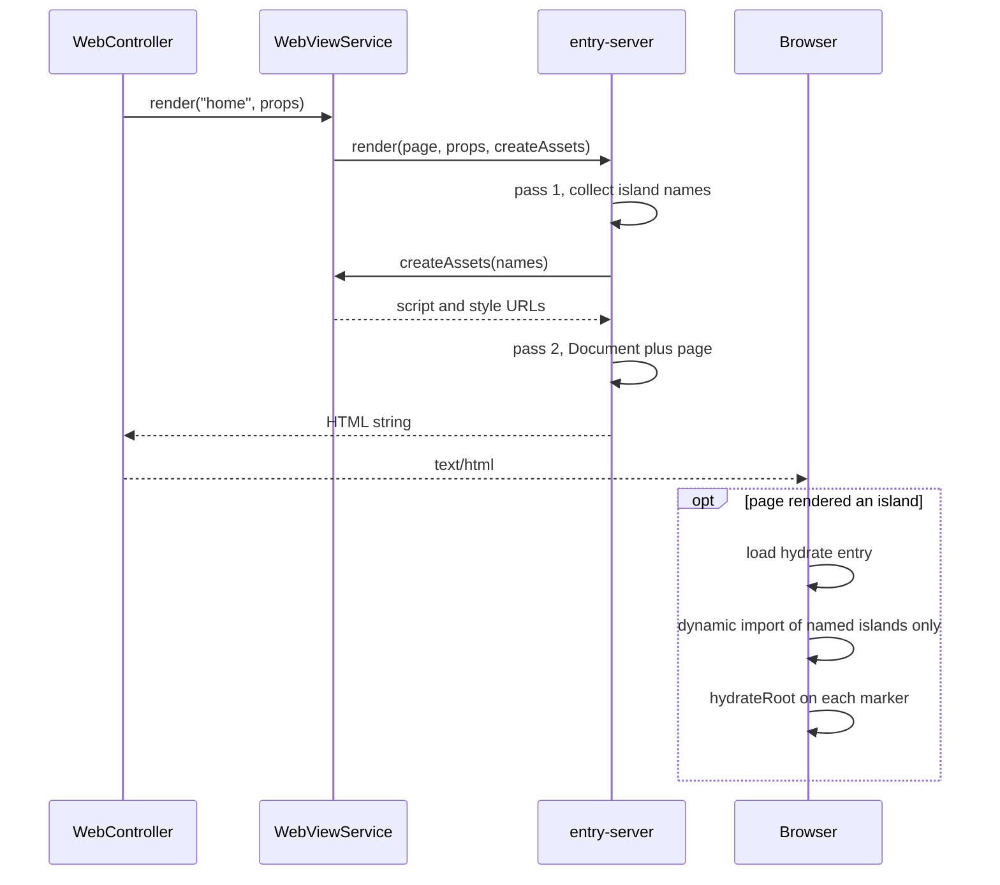
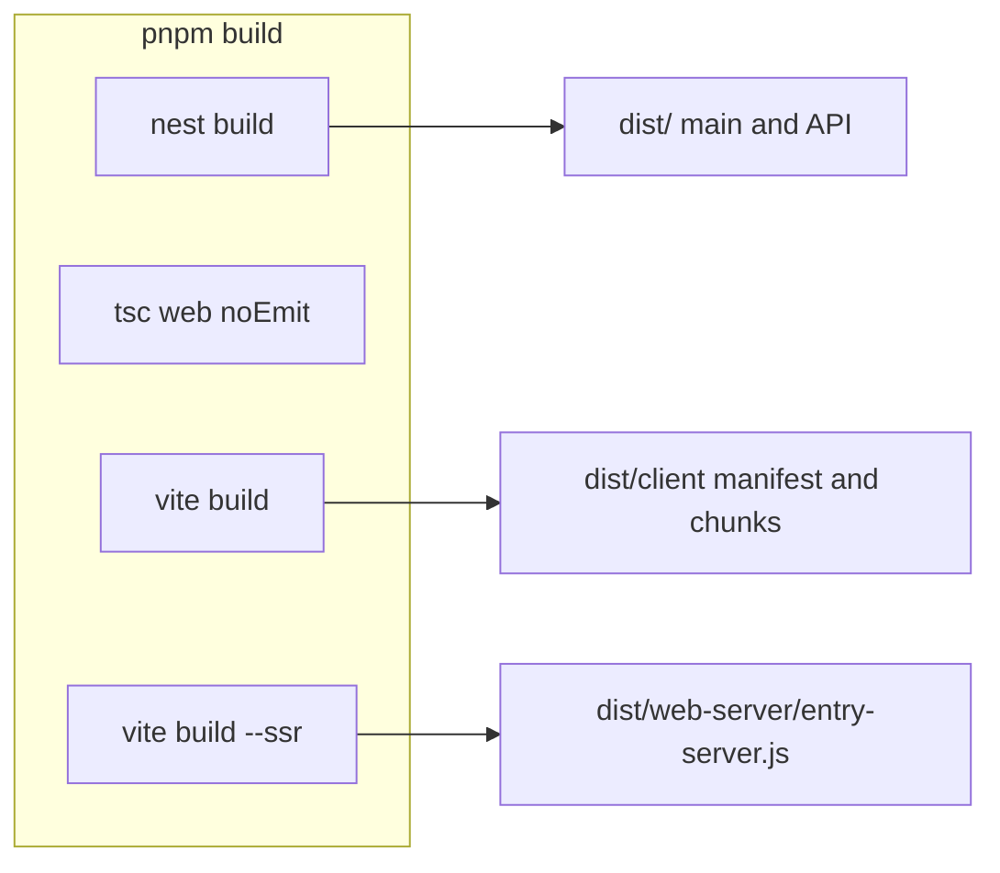

# Architecture

One Nest process serves two surfaces. The JSON API lives under `/api`. HTML pages live at the root. Nest owns routes and data. React owns the HTML: it server-renders the document and hydrates only the islands a page actually rendered.

A controller picks a page name and a plain props object. It does not import `.tsx`. See [ADR-0001](./adr/0001-one-nest-process.md) and [ADR-0002](./adr/0002-islands-ssr-ui.md). Decision index: [docs/adr/](./adr/README.md).

## Request split



| Surface     | Owner           | Examples                                                  | Response                                               |
| ----------- | --------------- | --------------------------------------------------------- | ------------------------------------------------------ |
| JSON API    | `src/api`       | `GET /api`, `POST /api/user`, `GET /api/docs`             | JSON, or the hello string                              |
| HTML pages  | `src/web`       | `GET /`                                                   | `text/html`                                            |
| Dev assets  | Vite middleware | `/@vite/client`, `/src/web/ui/runtime/island/hydrate.tsx` | Modules, only when `NODE_ENV` is not `production`      |
| Prod assets | `dist/client`   | `/assets/...`                                             | Built client files, `index: false` so `/` stays a page |

`GET /user` and `GET /docs` are not aliases. They 404. Swagger UI is `/api/docs`. The raw spec is `/api/docs-json`.

Page controllers must not claim `/api`, `/assets`, `/src`, or `/@vite`. Those prefixes belong to the API, the production client build, or the Vite dev server.

`LoggerMiddleware` runs on every route and then calls through.

## Source layout

Folder names do not create URL prefixes. `RouterModule` does ([ADR-0003](./adr/0003-router-module-prefixes.md)).

```text
src/
  main.ts                 bootstrap
  app.module.ts           wires API, web, and the /api prefix
  logger.middleware.ts
  api/                    JSON feature code
    api.module.ts
    app.controller.ts     GET /api
    openapi.setup.ts
    common/               password hashing, Zod to OpenAPI
    user/                 users (controller, service, repository port/adapter)
  persistence/            PrismaModule / PrismaService / PrismaPg helper
  generated/prisma/       Prisma Client output (`prisma generate`; gitignored)
  web/                    HTML host + embedded Vite UI ([ADR-0023](./adr/0023-web-host-ui-protocol.md))
    web.module.ts         Nest module (controller + view service)
    web.controller.ts     page routes
    web-view.service.ts
    host/                 Nest-executed SSR host (page-loader, asset-delivery)
    protocol/             Wire types: SSR page props, PageAssets, island CSS catalog
    ui/                   Embedded Vite/React app
      pages/              Per-page folders (<name>-page/) + thin index.ts
      islands/            Per-island folders (+ optional *.module.scss) + thin index.ts
      server-components/  Per-component folders (incl. document/) + thin index.ts
      shared-components/  Per-component folders (e.g. icon/) + thin index.ts
      runtime/island/     Island marker, loaders registry, props codec, hydrate
      runtime/ssr/        entry-server only
      api-fetch/          browser CSRF + fetch defaults
      hooks/              island React hooks
      styles/             shell.scss + forms.scss + _*.scss partials
      vite-plugins/       shell budget + island CSS Vite plugins
```

`tsconfig.build.json` excludes `src/web/ui/**`, so `nest build` never emits the React app. `tsconfig.web.json` typechecks `ui/**` + `protocol/**`. Repo-root `tsconfig.json` excludes `src/web/ui/**`. `pnpm build` still runs `tsc -p tsconfig.web.json --noEmit`. Vite emits the bundles that actually run. See [ADR-0017](./adr/0017-dual-typescript-build.md) and [ADR-0023](./adr/0023-web-host-ui-protocol.md).

**Import specifiers:** Nest-emitted graphs (`src/api/`, Nest web root, `host/`, `protocol/`) use relative **`.js`** emit names under `"type": "module"` + `nodenext`. Vite-owned `src/web/ui/**` uses **extensionless** relatives (`bundler` resolution), except `ui/vite-plugins/**` (Node config graph → `.js`). Style follows the importing file’s zone (UI→protocol is extensionless). See [ADR-0024](./adr/0024-dual-import-resolution.md). Product UI components use **one folder per component** with a thin `index.ts` barrel; island hydrate loaders import the concrete implementation file ([ADR-0025](./adr/0025-per-component-folders.md)). Colocated Storybook stories (`pnpm storybook`) are a local workshop, not QA ([ADR-0026](./adr/0026-storybook-ui-workshop.md)).

Prefer `.tsx` where the file is mostly a React tree (pages, islands, document, hydrate entry). Prefer plain `.ts` for Nest controllers, services, protocol props, registries, and tests. Specs stay `.ts` and use `createElement` when they need elements; a test may pass an explicit type argument (for example `Island<{ start: number }>`) so `component` and `props` still typecheck.

## JSON API

### Routing

`AppModule` registers the prefix on the module that owns the controllers ([ADR-0003](./adr/0003-router-module-prefixes.md)):

```ts
RouterModule.register([
  {
    path: 'api',
    module: ApiModule,
    children: [{ path: '/', module: UserModule }],
  },
]);
```

`RouterModule` sets the path on that module, not on modules it merely imports. `UserModule` is listed as a child so `@Controller('user')` becomes `/api/user`. `AppController` sits on `ApiModule`, so its `@Controller()` route is `GET /api`.

E2E boots `AppModule` and never runs `src/main.ts`. The prefix lives in the module graph. A test that imports `UserModule` alone will not see `/api`.

`WebModule` is imported with no path, so page routes stay at the root.

### Zod and the validation pipe

`main.ts` installs `StandardSchemaValidationPipe` globally ([ADR-0004](./adr/0004-zod-standard-schema-http.md)). Controllers pass the Zod schema on the parameter decorator. The pipe validates and transforms the value before the handler runs. A failure is HTTP 400.

```ts
@Body({ schema: createUserSchema }) createUserDto: CreateUserDto
@Param('id', { schema: userIdSchema }) id: string
```

Schemas are the source of the TypeScript types (`z.infer`). Current contracts:

| Schema               | Rules                                                                                                                                                                                                                                                         |
| -------------------- | ------------------------------------------------------------------------------------------------------------------------------------------------------------------------------------------------------------------------------------------------------------- |
| `createUserSchema`   | Strict object: email, username, display name, password via shared `passwordSchema` (min 12 / max 128, NIST-oriented; no composition rules). Unknown keys are rejected. Usernames are trimmed, a leading `@` is stripped, then checked for length and pattern. |
| `updateUserSchema`   | Create schema without email and username, every remaining field optional, still strict, and at least one of `displayName` or `password` is required.                                                                                                          |
| `userIdSchema`       | UUID path parameter.                                                                                                                                                                                                                                          |
| `userResponseSchema` | Public user: `id`, `email`, `username`, `displayName`, `verified`. No password.                                                                                                                                                                               |

### Users, passwords, and responses

`UserService` builds domain `User` values (UUID, Argon2id hash, field-by-field from the DTO) and persists them through a **repository port** (`USER_REPOSITORY` / `UserRepository`). The Prisma adapter (`PrismaUserRepository`) is the only place that imports the generated Prisma Client. Controllers and the service never depend on Prisma types. Feature mapping lives in `user.mapper.ts`: persistence row → domain (`toDomainUser`) and domain → public DTO (`toUserResponseDto`). See [ADR-0005](./adr/0005-persistence-postgres-prisma.md), [ADR-0008](./adr/0008-argon2id-passwords.md), and [ADR-0009](./adr/0009-allowlisted-responses-delete-204.md).

Email and username uniqueness is enforced by Postgres expression unique indexes on `LOWER(email)` and `LOWER(username)` (see `prisma/migrations`). Unique violations surface as Prisma `P2002` and become HTTP 409 in the adapter.

`hashPassword` uses Argon2id. Cost parameters are constants in `src/api/common/password.ts` (see [TD-005](./known-tech-debt.md)). The Prisma seed imports the same helper so hashing does not drift.

`toUserResponseDto` returns an allowlisted object. There is no response interceptor that filters bodies at the edge yet (see [TD-007](./known-tech-debt.md)).

Delete returns 204 whether or not the id existed.

`POST /api/user` is guest signup (CSRF + rate limit). `PATCH`/`DELETE` require an authenticated session and ownership of `:id` ([ADR-0007](./adr/0007-user-mutation-authz.md)). The public list endpoint was removed.

### Sessions and CSRF

Browser mutations use cookie sessions plus a CSRF token ([ADR-0006](./adr/0006-cookie-sessions-csrf.md)):

- **Session middleware** loads or creates a guest session from the HttpOnly `sid` cookie and attaches it to the request for HTML pages and `/api` (Vite/static asset paths are skipped).
- **CsrfGuard** (global) requires header `X-CSRF-TOKEN` to match the session token on mutating `/api` methods (`POST` / `PATCH` / `DELETE` / `PUT`). Safe methods and non-API routes pass through.
- SSR embeds `<meta name="csrf-token" content="…">` on HTML documents. There is **no** JSON CSRF mint endpoint; e2e obtains the token by loading `/register` or `/login` (same as the browser).
- Login regenerates the session id and attaches `userId` (see AuthModule). Session rows live in Postgres (`sessions`).



### Frontend contract (islands → API)

Login/register islands submit via `useApiMutation` (react-hook-form + Zod on the forms). Keep client and server aligned:

1. Read `<meta name="csrf-token">` via `getCsrfToken` / `getCsrfTokenHeader` under `src/web/ui/api-fetch/`.
2. Call `/api/...` with native `fetch`, spreading `apiRequestDefaults` (`credentials: 'same-origin'`, JSON content type) and `...getCsrfTokenHeader()`.
3. Reuse shared Zod pieces from `src/shared/schemas/` (e.g. `passwordSchema`, `emailSchema`) and compose with API DTOs (`createUserSchema`, `loginSchema`) for RHF resolvers — do not re-state field rules in the island.
4. Map HTTP outcomes to UI: client Zod / **400** field errors, **409** uniqueness on register, **401** generic login failure (“Invalid credentials”), **403** missing/invalid CSRF, **429** throttle. Form-level API errors use plain colored text (`.form-api-error`), not Bootstrap alerts.
5. Register succeeds with **201** then navigates to `/login` (no auto-login). Login succeeds with **200** then navigates to `/`. Logout is best-effort (always navigate to `/login` after the attempt).
6. Nav auth chrome is SSR-driven from `req.session.userId` (`isAuthenticated` page prop). `/login` and `/register` redirect authenticated users to `/`.

UI unit tests run in Vitest browser mode; auth journeys use Playwright against Nest ([ADR-0021](./adr/0021-vitest-browser-ui-testing.md)). HTTP e2e remains the API contract gate. Local browser installs target Playwright’s durable default cache via `env -u PLAYWRIGHT_BROWSERS_PATH` on Unix/WSL ([ADR-0022](./adr/0022-unix-wsl-playwright-browser-cache.md); [TD-027](./known-tech-debt.md)).

### Persistence

PostgreSQL is the system of record. Prisma 7 owns the database schema and CLI; the app talks through `@prisma/adapter-pg`. Zod owns HTTP contracts. Domain `User` is the port type. `PrismaService` composes `PrismaClient`. See [ADR-0005](./adr/0005-persistence-postgres-prisma.md). Global Prisma module init always `$connect`s for the process lifetime (see [TD-012](./known-tech-debt.md)).

`prisma generate` writes the Prisma Client to `src/generated/prisma` (gitignored). SQL history lives in `prisma/migrations/` and is applied with `prisma migrate deploy`.



| Concern         | How                                                                                                                                       |
| --------------- | ----------------------------------------------------------------------------------------------------------------------------------------- |
| Local manual DB | Docker Compose (`docker-compose.yml`) + GNU Make (`make db-up`, `make db-migrate`, `make db-seed`)                                        |
| App connection  | `DATABASE_URL` in `.env` / `prisma.config.ts` (see `.env.example`); required for migrate/seed/runtime, not for generate alone             |
| Nest wiring     | Global `PrismaModule` / `PrismaService` (composes `PrismaClient` + PrismaPg); `UserModule` factory-binds the repository adapter           |
| E2E database    | Testcontainers Postgres (not Compose); migrate deploy once per run; truncate between tests ([ADR-0010](./adr/0010-e2e-testcontainers.md)) |
| Client codegen  | `prisma generate` → `src/generated/prisma` on `postinstall` and at the start of `pnpm build` (works without a live DB / `.env`)           |

### OpenAPI

`setupOpenApi` runs after the global pipe so the documented routes match runtime validation ([ADR-0004](./adr/0004-zod-standard-schema-http.md)). `SwaggerModule.setup('api/docs', ...)` serves the UI. Nest exposes the raw document at `/api/docs-json`. The document is built on first request.

Response schemas are generated from Zod, using the output shape:

```ts
z.toJSONSchema(schema, { target: 'openapi-3.0', io: 'output' });
```

Controllers attach those objects with `@ApiOkResponse`, `@ApiCreatedResponse`, and the error decorators. `WebController` is marked `@ApiExcludeController()`, so HTML routes stay out of the spec.

Swagger is served in every environment today while the app is local-only (see [TD-006](./known-tech-debt.md)).



## Web pages

### Roles

| Piece                          | Responsibility                                                    |
| ------------------------------ | ----------------------------------------------------------------- |
| `WebController`                | Chooses the page name and builds JSON props. Sets `text/html`.    |
| `WebViewService`               | Loads the server entry and asks it to render.                     |
| `runtime/ssr/entry-server.tsx` | Maps the page name to a React component and renders the document. |
| Page component                 | Server-only body. May place islands in the tree.                  |
| `Island`                       | Server-renders the component and writes the hydration marker.     |
| `runtime/island/hydrate.tsx`   | Browser entry. Hydrates markers and nothing else.                 |

SSR embed props live in `protocol/page-props/*-page.ssr-props.ts` (`*PageSsrProps`). The controller imports those types, not the component ([ADR-0023](./adr/0023-web-host-ui-protocol.md)).

`loadServerEntry` builds the module specifier at runtime:

- Development: `vite.ssrLoadModule('/src/web/ui/runtime/ssr/entry-server.tsx')`.
- Tests: a dynamic import of `runtime/ssr/entry-server.tsx` next to the loader, so Vitest transforms it.
- Production: `dist/web-server/entry-server.js`.

A static `import './runtime/ssr/entry-server.tsx'` from Nest would pull React into the Nest compile ([ADR-0017](./adr/0017-dual-typescript-build.md)).

### Server render

Rendering is two passes of `renderToString` ([ADR-0011](./adr/0011-two-pass-render-to-string.md)).



Pass 1 renders the page inside `IslandNamesContext`. Each `Island` adds its name to that set. Pass 2 renders `Document` around the same page. The context is null on pass 2, so the second render still emits the marker and the server HTML, and it does not change the asset list.

`createAssets([])` returns the shared stylesheet and no scripts. A page with no islands does not download the hydrate entry.

The home page keeps its sentence in one template string. Adjacent text expressions would become HTML comments, and the sentence would not match as a single string.

### Islands

An island is a client component with its own React root. The server page places it with the `Island` helper (`Island<P>`). See [ADR-0012](./adr/0012-island-boundaries.md).

The server marker is:

```html
<div data-island="mobile-navigation" data-props="...">
  <!-- island SSR HTML -->
</div>
```

`data-props` is `encodeURIComponent(JSON.stringify(props))`. The decoder rejects arrays, null, and non-objects. Props must be JSON-serializable plain objects.

`hydrateRoot` is called on the marker element. React hydrates the component as that element's children. The marker div is the container, not part of the component tree.

Islands do not share React context or state after hydration (see [TD-008](./known-tech-debt.md)).

### Lazy chunks

The client entry imports the registry, not the island components:

```ts
export const islandLoaders = {
  'mobile-navigation': loadMobileNavigationIsland,
} as const;

function loadMobileNavigationIsland() {
  return import('../../islands/mobile-navigation/mobile-navigation');
}
```

Vite emits a separate chunk per dynamic `import()`. `assetTagsFromManifest` emits the hydrate entry and its static `imports`; it does not walk `dynamicImports`. Vite may still inject runtime `modulepreload` when a dynamic `import()` runs ([ADR-0012](./adr/0012-island-boundaries.md); revisit with [TD-010](./known-tech-debt.md)).

The registry's `isIslandName` check uses `hasOwnProperty`. An unknown name throws before hydration.

Product islands live under `ui/islands/`; marker, loaders registry, props codec, and hydrate live under `ui/runtime/island/` ([ADR-0018](./adr/0018-island-runtime-folder.md); [TD-019](./known-tech-debt.md) closed). Nest stays at the `src/web/` root; Nest engines under `host/`; wire types under `protocol/`; React under `ui/` ([ADR-0023](./adr/0023-web-host-ui-protocol.md); earlier folder ADRs 0018/0020 retain history).

### Styles

Authoring rules (when to island / module / sibling): [how-to-web-ui.md](./how-to-web-ui.md). Decisions: [ADR-0013](./adr/0013-css-three-lanes.md), [ADR-0014](./adr/0014-forms-sibling-stylesheet.md), [ADR-0015](./adr/0015-island-css-sibling-style.md).

CSS ships in **three lanes**:

| Lane                   | When                                             | Role                                                                       |
| ---------------------- | ------------------------------------------------ | -------------------------------------------------------------------------- |
| **Shell**              | Every HTML page                                  | Shared layout/content language                                             |
| **Page sibling sheet** | Only pages that opt in (`pageStylesheetsByPage`) | Shared Bootstrap component CSS that must not tax every page (today: forms) |
| **Island module**      | Only when that island is rendered                | Small non-Bootstrap interaction decoration; tokens-only Sass API           |

**Shell** (`src/web/ui/styles/shell.scss`): handpicked Bootstrap Option B — config (including the utilities Sass map), `root`, `reboot`, `type`, `images`, `containers`, and `grid`, plus handpicked `_buttons.scss`. No Bootstrap forms in the shell. Own Vite client input. Compilation: Sass → PostCSS (media-query sort + doiuse warn) → Lightning CSS minify at **Baseline Widely Available**. Build **reports** raw + gzip vs `SHELL_CSS_BUDGET_BYTES` (default 50 KiB). **Production** inlines the shell as `<style data-css="shell">` when **raw** size ≤ that budget; otherwise keeps a `<link>`. **Development** always `<link href="/src/web/ui/styles/shell.scss">` plus `/@vite/client` for HMR. Fixture tests cover both shell modes.

**Forms sibling:** [`src/web/ui/styles/forms.scss`](../src/web/ui/styles/forms.scss) (Vite input `forms`). Pages list `'forms'` in [`pageStylesheetsByPage`](../src/web/host/asset-delivery/page-stylesheets.ts). Selective Bootstrap partials: `forms/labels`, `forms/form-control`, `forms/form-text`, `forms/validation`. Measured size ~11 KiB raw / ~2 KiB gzip. Revisit triggers: [TD-021](./known-tech-debt.md).

**Island CSS:** Import `*.module.scss` beside the component; use `styles/_tokens.scss` for Sass API only. Do not re-import shell or Bootstrap CSS-emitting partials ([TD-016](./known-tech-debt.md)). After SSR pass 1, `createPageAssets` loads CSS text; `Island` emits a sibling `<style data-css-island="{name}">` above the marker. Hydrate loads JS only (mapDeps CSS filtered in prod; `updateStyle` rewritten in dev).

```html
<style data-css-island="mobile-navigation">
  /* hashed module rules */
</style>
<div data-island="mobile-navigation" data-props="…">…</div>
```

**Icons:** Handpicked Bootstrap Icons SVGs in [`src/web/ui/shared-components/icon/`](../src/web/ui/shared-components/icon/) ([ADR-0016](./adr/0016-handpicked-bootstrap-icons.md)). Authoring: [how-to-web-ui.md](./how-to-web-ui.md#icons).

Hydrating every island as soon as the entry loads (including below the fold) is still [TD-010](./known-tech-debt.md) for **JS**; CSS for used islands is already in the HTML.

### Development and production

|                                          | Development                                                                                                                                                                                                                                                                              | Production                                                                                                                                                |
| ---------------------------------------- | ---------------------------------------------------------------------------------------------------------------------------------------------------------------------------------------------------------------------------------------------------------------------------------------- | --------------------------------------------------------------------------------------------------------------------------------------------------------- |
| How it starts                            | `pnpm start` / `start:dev`                                                                                                                                                                                                                                                               | `NODE_ENV=production` via `pnpm start:prod`                                                                                                               |
| SSR                                      | Vite middleware mode, `ssrLoadModule`                                                                                                                                                                                                                                                    | `dist/web-server/entry-server.js`                                                                                                                         |
| Client scripts when an island is present | `/@id/@vitejs/plugin-react/preamble`, `/@vite/client`, `/src/web/ui/runtime/island/hydrate.tsx`                                                                                                                                                                                          | Manifest entry and its static imports, under `/`                                                                                                          |
| Styles                                   | Shell `<link href="/src/web/ui/styles/shell.scss">` plus `/@vite/client`. Opt-in siblings (e.g. forms) as extra `<link>`s when the page opts in. Island CSS inlined as sibling `<style>`; Vite client inject is rewritten to update that sibling (no `data-vite-dev-id` head duplicate). | Shell `<style>` or `<link>` by raw-size budget. Opt-in siblings as `<link>`s. Island CSS inlined as sibling `<style>`; hydrate mapDeps has no island CSS. |
| Static files                             | Vite serves source                                                                                                                                                                                                                                                                       | `express.static` on `dist/client`, with `index: false`                                                                                                    |

The React refresh preamble is required in development because this app writes its own HTML. Without `window.$RefreshReg$`, an island module throws before `hydrateRoot` runs. Production builds do not include the refresh runtime.

`pnpm build` runs four steps ([ADR-0017](./adr/0017-dual-typescript-build.md)): `nest build`, `tsc -p tsconfig.web.json --noEmit`, `vite build` (client), and `vite build --ssr`. `emptyOutDir` is false on both Vite builds so they can share `dist/`.



## Adding a page or island

Follow [how-to-web-ui.md](./how-to-web-ui.md) (`pnpm scaffold:web-ui` or the `create-web-ui` agent skill).

## Related docs

- [Architecture Decision Records](./adr/README.md) — durable tradeoffs (ADR-0001–ADR-0017).
- [How to add web UI](./how-to-web-ui.md) — SSR vs island vs module styles; handpicked icons; anti-patterns; scaffold.
- [Testing and coverage](./testing-and-coverage.md) — unit/e2e/coverage policy; Testcontainers for e2e ([ADR-0010](./adr/0010-e2e-testcontainers.md)).
- [Known tech debt](./known-tech-debt.md) — deferred work (TD-IDs). Shared island client state is TD-008; below-the-fold hydrate is TD-010.
