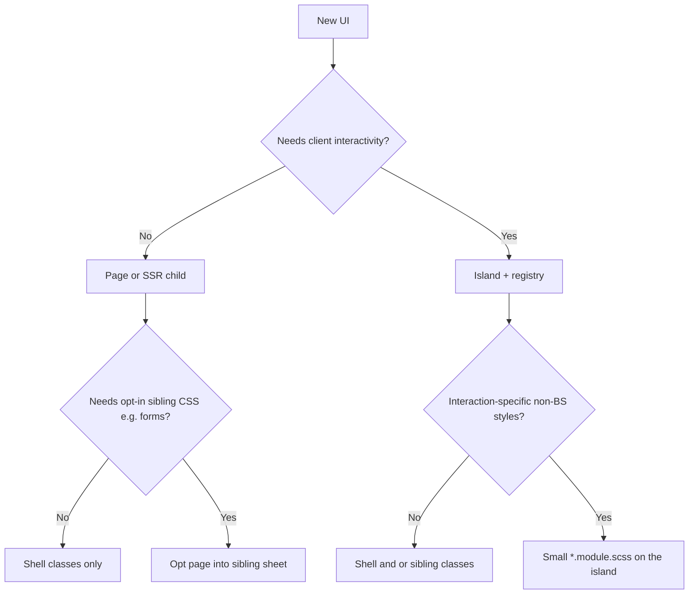

# How to add web UI (pages, islands, styles)

Canonical decision tree for HTML UI in this Nest + islands app. Follow it when scaffolding by hand, via `pnpm scaffold:web-ui`, or with the `create-web-ui` agent skill. Deeper delivery mechanics live in [architecture.md](./architecture.md#styles).

## Decision tree

1. **Static / SSR-only** (no client state, no hydrate-worthy events) → page or presentational child under `src/web/pages/`. **Not** an island. Style with the **shell** and, if needed, an **opt-in page sibling** sheet (not a CSS module).
2. **Needs interactivity** (`useState`, clicks, browser APIs) → register an **island** and render `<Island>`.
3. **Needs styles beyond the shell / sibling** (spinner, open/closed, custom motion) → add a small `*.module.scss` beside the **island** component (CSS modules are canonical for island-owned rules).
4. **Needs shared Bootstrap component CSS that must not tax every page** (e.g. forms) → opt the page into a **sibling stylesheet** via `pageStylesheetsByPage`. Do **not** create an island just to attach that CSS. Rationale: [architecture.md](./architecture.md#optional-page-stylesheets-forms).

## Shell vs sibling vs island module

| Put in the shell (`styles.scss`)                        | Put in a page sibling sheet (`styles/forms.scss`, …)         | Put in island `*.module.scss`                               |
| ------------------------------------------------------- | ------------------------------------------------------------ | ----------------------------------------------------------- |
| Handpicked Bootstrap: reset, type, colors, images, grid | Shared BS form (or similar) partials for opted-in pages only | Hover/focus after _custom_ interaction, spinner, open state |
| First-paint page chrome that would CLS without it       | Today: labels, form-control, form-text, validation           | Island-only decoration tied to behavior                     |
| Always-on design-system look                            | Declared in `pageStylesheetsByPage`                          | Keep the file small — not a second framework                |

**Target shell:** layout and content language (`root` / `reboot` / `type` / `images` / `containers` / `grid`) plus handpicked buttons — not Bootstrap forms or other heavy component stacks. Build interactive chrome as islands with small modules when needed. **Forms (including validation CSS)** live on the opt-in sibling — see [architecture.md](./architecture.md#optional-page-stylesheets-forms).

## Steps: SSR-only page piece

1. Add or extend a page under `src/web/pages/`.
2. Use shell classes (grid/type/images). Do **not** import a CSS module.
3. If the page needs forms (or another opt-in sibling), add the sheet id to `pageStylesheetsByPage` for that page name.
4. Wire the controller / `entry-server` page map as in architecture.md.

## Steps: opt-in page sibling stylesheet

1. Prefer growing an existing sibling (e.g. add a Bootstrap forms partial to `styles/forms.scss`) over a new Vite input.
2. Register the sheet in `pageStylesheetRegistry` / Vite `build.rollupOptions.input` only when introducing a **new** sibling entry.
3. List the sheet under the page in `pageStylesheetsByPage`. Home and other non-users must stay empty for that sheet.
4. Use global Bootstrap class names in markup (`form-control`, …). Do not wrap the sibling in an island CSS module.

## Steps: interactive island

1. Component under `src/web/islands/` with a default export and JSON-serializable props.
2. Optional: `import styles from './name.module.scss'` and `styles/_tokens.scss` for Sass API only — never re-import the shell sheet or Bootstrap CSS-emitting partials (including forms/validation).
3. Register in `islandRegistry` / `islandLoaders` with `cssModulePath` when you have a module (dev SSR inlining).
4. Render `<Island name="…" component={…} props={…} />` from a page. Do **not** wire CSS context yourself — the framework fills it after the name-collection pass and emits a sibling `<style data-css-island>` for used islands (deduped by name).
5. Hydrate still loads **JS only** for that island; CSS was already inlined in the HTML.

Scaffold: `pnpm scaffold:web-ui --name my-widget --mode island --with-styles` (or omit `--with-styles`). Agents: use `.agents/skills/create-web-ui/SKILL.md`.

## Icons

Icons are **handpicked Bootstrap Icons** SVGs, same download-only-what-you-need rule as the shell Sass stack. There is no `bootstrap-icons` font/CSS package and no icon CDN.

Canonical helper: [`src/web/shared/icon.tsx`](../src/web/shared/icon.tsx).

1. Find the icon on [Bootstrap Icons](https://icons.getbootstrap.com/).
2. Copy its inline SVG into a small function in `icon.tsx` and register it on the `icons` map (use the Bootstrap name, e.g. `list`, `x-lg`).
3. Render with `<Icon name="list" />` from **SSR components** (`src/web/ssr-components/`) or **islands** (`src/web/islands/`). Both may import the shared helper.
4. Prefer `fill="currentColor"` so shell / module `color` styles the glyph. In React, use camelCase SVG attributes (`fillRule`, not `fill-rule`).

Do **not** add icons ad hoc inside a single island or page when others will need them — extend `icon.tsx` so the registry stays the one source of available glyphs.

## Auth forms (login / register islands)

Login/register use react-hook-form + Zod and `useApiMutation`:

- Prefer `formState.isSubmitting` for form pending UI; use the mutation hook’s `isPending` only for non-form islands (e.g. logout).
- Spread `apiRequestDefaults` and `...getCsrfTokenHeader()` into native `fetch` (helpers in `src/web/client/`; hook in `src/web/hooks/`).
- Import shared schemas from `src/shared/schemas/` and API DTOs under `src/api/.../dto` rather than duplicating password/username rules.
- Form-level API errors: plain colored text (`.form-api-error`), not Bootstrap alerts.
- See [architecture.md — Frontend contract](./architecture.md#frontend-contract-islands--api) for status codes and redirects. Browser UI-state tests are TD-025.

## Anti-patterns

- **SSR-only component importing a CSS module** — If it is not interactive, it should not need interaction-specific styles. Extend the shell, opt into a page sibling, or promote to an island because it will gain interaction.
- **Island only to attach component CSS, with no interactive JS** — Do not wrap static markup in `<Island>` “for styling.” Use a page sibling sheet for shared Bootstrap component CSS (forms). That drifts from the shell design system and ships hydrate for zero behavior.
- Re-importing shell / Bootstrap **component** SCSS into an island module (forms/validation included — those belong on the forms sibling).
- Growing a utility layer or mini-Bootstrap inside island modules.
- Putting optional component CSS into the shell “just in case” (forms stay opt-in).
- Shipping the full Bootstrap Icons webfont / CSS sprite, or pasting one-off SVGs into islands instead of registering them in `shared/icon.tsx`.
