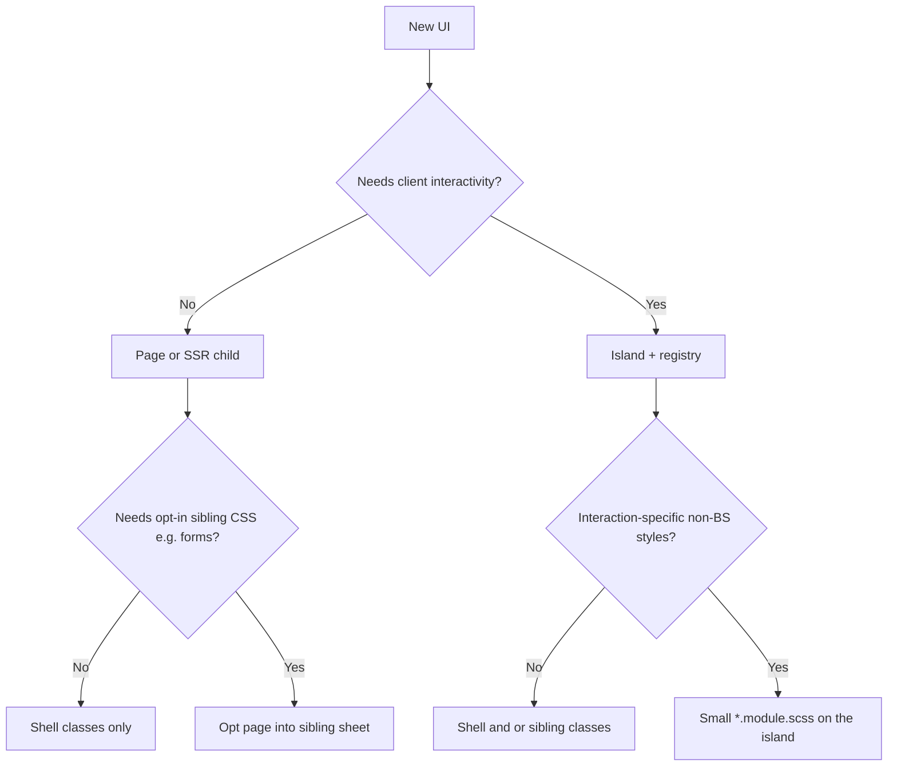

# How to add web UI (pages, islands, styles)

Canonical decision tree for HTML UI in this Nest + islands app. Follow it when scaffolding by hand, via `pnpm scaffold:web-ui`, or with the `create-web-ui` agent skill. Delivery mechanics: [architecture.md](./architecture.md#styles). Why three lanes / forms sibling / island `<style>`: [ADR-0013](./adr/0013-css-three-lanes.md), [ADR-0014](./adr/0014-forms-sibling-stylesheet.md), [ADR-0015](./adr/0015-island-css-sibling-style.md). Host / UI / protocol: [ADR-0023](./adr/0023-web-host-ui-protocol.md); tree in [architecture.md](./architecture.md).

## Where things live (`src/web/`)

| Path                                                  | Put here                                                                                                                                                                               |
| ----------------------------------------------------- | -------------------------------------------------------------------------------------------------------------------------------------------------------------------------------------- |
| Nest root (`web.module.ts`, controller, view service) | Nest wiring only                                                                                                                                                                       |
| `host/`                                               | Nest-executed SSR host (`page-loader`, `asset-delivery`)                                                                                                                               |
| `protocol/`                                           | Wire types/data: SSR page props, `ServerEntry`, `PageAssets`, island CSS catalog                                                                                                       |
| `protocol/page-props/`                                | `*-page.ssr-props.ts` + `SsrPagePropsMap` (not next to UI pages)                                                                                                                       |
| `ui/pages/<name>-page/`                               | One folder per page: kebab `.tsx`, thin `index.ts`, optional spec / `*.stories.tsx` ([ADR-0025](./adr/0025-per-component-folders.md), [ADR-0026](./adr/0026-storybook-ui-workshop.md)) |
| `ui/server-components/<name>/`                        | One folder per server component (incl. `document/`) + thin `index.ts` (stories except `document/`)                                                                                     |
| `ui/shared-components/<name>/`                        | One folder per shared component (e.g. `icon/`) + thin `index.ts` + stories                                                                                                             |
| `ui/islands/<name>/`                                  | One folder per island: `.tsx`, optional `.module.scss` / spec / `*.stories.tsx`, thin `index.ts`                                                                                       |
| `ui/runtime/island/`                                  | Island marker, loaders registry, props codec, hydrate entry                                                                                                                            |
| `ui/runtime/ssr/`                                     | `entry-server` only                                                                                                                                                                    |
| `ui/styles/`                                          | `shell.scss`, opt-in siblings (`forms.scss`), `_*.scss` partials                                                                                                                       |
| `ui/api-fetch/`                                       | Browser CSRF + `fetch` defaults for `/api`                                                                                                                                             |
| `ui/hooks/`                                           | Island React hooks (e.g. `use-api-mutation`)                                                                                                                                           |
| `ui/vite-plugins/`                                    | Vite build plugins                                                                                                                                                                     |

Do **not** put product UI under `host/`; do **not** put Nest-executed engines under `ui/`. Both may import `protocol/` only.

**Relative imports in `ui/` are extensionless** (no `.js` suffix), except `ui/vite-plugins/**` which use `.js` because they load in Vite’s Node config graph. Nest zones (`api/`, `host/`, `protocol/`, Nest web root) keep `.js` emit specifiers. Do not copy the Nest style into islands/pages. See [ADR-0024](./adr/0024-dual-import-resolution.md).

**Path aliases when leaving a component folder** ([ADR-0027](./adr/0027-ui-path-aliases.md)): use `@ui/…`, `@protocol/…`, or `@api/…` instead of climbing with `../`. Keep `./` for same-folder siblings / thin barrels. Example: `import LoginForm from '@ui/islands/login-form'` and `import type { LoginPageSsrProps } from '@protocol/page-props/login-page.ssr-props'`.

## SSR page props quirk

SSR embed props look like “the page’s props,” but they are a Nest→Vite **embed contract**:

1. Nest builds them; the Vite SSR page consumes them (not a React parent).
2. JSON-serializable plain data only.
3. Nest must not import `ui/pages/*.tsx`, so contracts live in `protocol/page-props/` as `*-page.ssr-props.ts` / `*PageSsrProps`.
4. Do not colocate them under `ui/pages/` (including future per-component folders).
5. Island props are separate (component props + `data-props` marker).

See [ADR-0023](./adr/0023-web-host-ui-protocol.md).

## Decision tree

1. **Static / SSR-only** (no client state, no hydrate-worthy events) → page under `src/web/ui/pages/`. **Not** an island. Style with the **shell** and, if needed, an **opt-in page sibling** sheet (not a CSS module).
2. **Needs interactivity** (`useState`, clicks, browser APIs) → register an **island** and render `<Island>`.
3. **Needs styles beyond the shell / sibling** (spinner, open/closed, custom motion) → add a small `*.module.scss` beside the **island** component (CSS modules are canonical for island-owned rules).
4. **Needs shared Bootstrap component CSS that must not tax every page** (e.g. forms) → opt the page into a **sibling stylesheet** via `pageStylesheetsByPage`. Do **not** create an island just to attach that CSS. Rationale: [ADR-0014](./adr/0014-forms-sibling-stylesheet.md).

## Shell vs sibling vs island module

| Put in the shell (`ui/styles/shell.scss`)               | Put in a page sibling sheet (`ui/styles/forms.scss`, …)      | Put in island `*.module.scss`                               |
| ------------------------------------------------------- | ------------------------------------------------------------ | ----------------------------------------------------------- |
| Handpicked Bootstrap: reset, type, colors, images, grid | Shared BS form (or similar) partials for opted-in pages only | Hover/focus after _custom_ interaction, spinner, open state |
| First-paint page chrome that would CLS without it       | Today: labels, form-control, form-text, validation           | Island-only decoration tied to behavior                     |
| Always-on design-system look                            | Declared in `pageStylesheetsByPage`                          | Keep the file small — not a second framework                |

**Target shell:** layout and content language (`root` / `reboot` / `type` / `images` / `containers` / `grid`) plus handpicked buttons — not Bootstrap forms or other heavy component stacks ([ADR-0013](./adr/0013-css-three-lanes.md)). Build interactive chrome as islands with small modules when needed. **Forms (including validation CSS)** live on the opt-in sibling ([ADR-0014](./adr/0014-forms-sibling-stylesheet.md)).

## Steps: SSR page

Pages are the Nest ↔ view boundary. Nest builds SSR embed props by page name and must **not** import page `.tsx` ([ADR-0017](./adr/0017-dual-typescript-build.md), [ADR-0023](./adr/0023-web-host-ui-protocol.md)).

1. Add `src/web/protocol/page-props/<name>-page.ssr-props.ts` with a JSON-serializable `*PageSsrProps` interface. Keep it plain `.ts` — no React imports.
2. Add `src/web/ui/pages/<name>-page/<name>-page.tsx` plus thin `index.ts` re-export; import the SSR props type from protocol; shell classes only (no CSS module).
3. Register the page in `src/web/protocol/page-props/page-props.ts`: add the type to `SsrPagePropsMap` (that also defines `WebPageName`).
4. Map the page in `ui/runtime/ssr/entry-server.tsx` (`pages` object) via the directory import.
5. Add a `WebController` method that builds the props object (typed from `protocol/page-props/` only) and calls `webViewService.render('<name>', props, …)`. Do **not** import the page `.tsx` from Nest.
6. If the page needs forms (or another opt-in sibling), list the sheet id under that page in `pageStylesheetsByPage` (host asset-delivery).

Scaffold: `pnpm scaffold:web-ui --name about --mode page` (writes protocol SSR props + UI page stub; you still wire `SsrPagePropsMap`, entry-server, and the controller). Agents: use `.agents/skills/create-web-ui/SKILL.md`.

## Steps: opt-in page sibling stylesheet

1. Prefer growing an existing sibling (e.g. add a Bootstrap forms partial to `ui/styles/forms.scss`) over a new Vite input.
2. Register the sheet in `pageStylesheetRegistry` / Vite `build.rollupOptions.input` only when introducing a **new** sibling entry.
3. List the sheet under the page in `pageStylesheetsByPage`. Home and other non-users must stay empty for that sheet.
4. Use global Bootstrap class names in markup (`form-control`, …). Do not wrap the sibling in an island CSS module.

## Steps: interactive island

1. Folder under `src/web/ui/islands/<name>/` with `<name>.tsx` (default export), thin `index.ts`, JSON-serializable props.
2. Optional: colocated `<name>.module.scss` (`@import '../../styles/tokens'`) — never re-import the shell sheet or Bootstrap CSS-emitting partials (including forms/validation).
3. Register concrete loaders in `ui/runtime/island/registry.ts` (`import('…/islands/<name>/<name>')`). Add the catalog row in `protocol/island-css-catalog.ts` (scaffold does both).
4. Render `<Island name="…" component={…} props={…} />` from a page (directory-import the island barrel; import `Island` from `ui/runtime/island/island`). Do **not** wire CSS context yourself — the framework fills it after the name-collection pass and emits a sibling `<style data-css-island>` for used islands (deduped by name).
5. Hydrate still loads **JS only** for that island; CSS was already inlined in the HTML.

Scaffold: `pnpm scaffold:web-ui --name my-widget --mode island --with-styles` (or omit `--with-styles`). Agents: use `.agents/skills/create-web-ui/SKILL.md`.

## Icons

Icons are **handpicked Bootstrap Icons** SVGs, same download-only-what-you-need rule as the shell Sass stack. There is no `bootstrap-icons` font/CSS package and no icon CDN.

Canonical helper: [`src/web/ui/shared-components/icon/`](../src/web/ui/shared-components/icon/).

1. Find the icon on [Bootstrap Icons](https://icons.getbootstrap.com/).
2. Copy its inline SVG into a small function in `icon.tsx` and register it on the `icons` map (use the Bootstrap name, e.g. `list`, `x-lg`).
3. Render with `<Icon name="list" />` from **server components** (`src/web/ui/server-components/`) or **islands** (`src/web/ui/islands/`). Both may import the shared helper.
4. Prefer `fill="currentColor"` so shell / module `color` styles the glyph. In React, use camelCase SVG attributes (`fillRule`, not `fill-rule`).

Do **not** add icons ad hoc inside a single island or page when others will need them — extend `icon.tsx` so the registry stays the one source of available glyphs.

## Auth forms (login / register islands)

Login/register use react-hook-form + Zod and `useApiMutation`:

- Prefer `formState.isSubmitting` for form pending UI; use the mutation hook’s `isPending` only for non-form islands (e.g. logout).
- Spread `apiRequestDefaults` and `...getCsrfTokenHeader()` into native `fetch` (helpers in `src/web/ui/api-fetch/`; hook in `src/web/ui/hooks/`).
- Import shared schemas from `src/shared/schemas/` and API DTOs under `src/api/.../dto` rather than duplicating password/username rules.
- Form-level API errors: plain colored text (`.form-api-error`), not Bootstrap alerts.
- See [architecture.md — Frontend contract](./architecture.md#frontend-contract-islands--api) for status codes and redirects.
- **Tests:** co-locate a browser-mode `*.spec.ts` next to interactive islands (Vitest browser project). When the UI navigates or mutates, add or extend `*.browser-e2e-spec.ts`. See [testing-and-coverage.md](./testing-and-coverage.md) and [ADR-0021](./adr/0021-vitest-browser-ui-testing.md).
- **Storybook workshop:** co-locate `*.stories.tsx` (scaffold emits a stub). Browse with `pnpm storybook` — visual/dev only, not a second test runner ([ADR-0026](./adr/0026-storybook-ui-workshop.md)). Skip stories for `Document` (nested `html`).

## Anti-patterns

- **SSR-only component importing a CSS module** — If it is not interactive, it should not need interaction-specific styles. Extend the shell, opt into a page sibling, or promote to an island because it will gain interaction.
- **Island only to attach component CSS, with no interactive JS** — Do not wrap static markup in `<Island>` “for styling.” Use a page sibling sheet for shared Bootstrap component CSS (forms). That drifts from the shell design system and ships hydrate for zero behavior.
- Re-importing shell / Bootstrap **component** SCSS into an island module (forms/validation included — those belong on the forms sibling).
- Growing a utility layer or mini-Bootstrap inside island modules.
- Putting optional component CSS into the shell “just in case” (forms stay opt-in).
- Shipping the full Bootstrap Icons webfont / CSS sprite, or pasting one-off SVGs into islands instead of registering them in `ui/shared-components/icon/`.
- Fat composition barrels or component-as-only-`index.tsx` (use kebab implementation + thin `index.ts` — [ADR-0025](./adr/0025-per-component-folders.md)).
- Putting Nest SSR props beside `ui/pages/` components, or Nest importing page `.tsx`.
