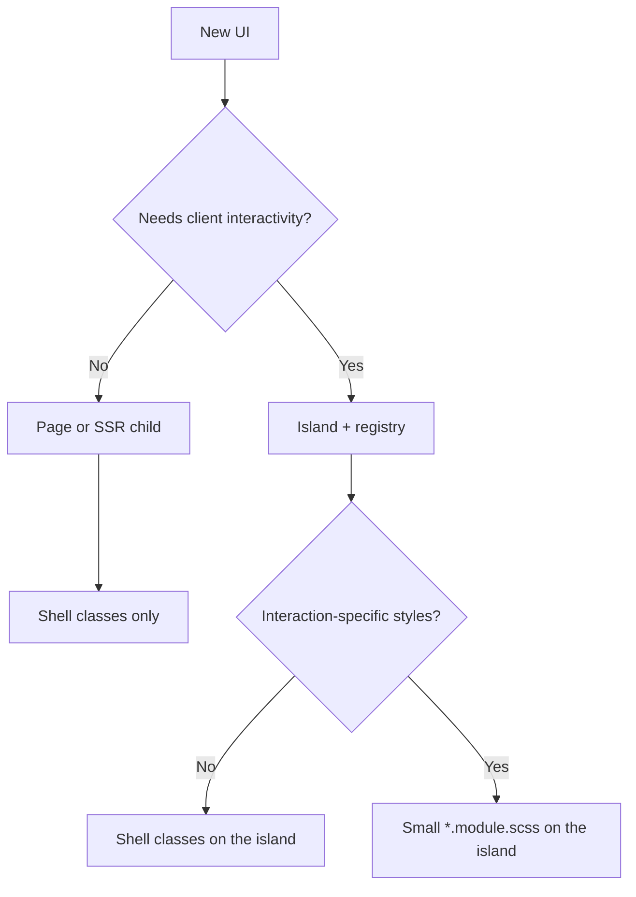

# How to add web UI (pages, islands, styles)

Canonical decision tree for HTML UI in this Nest + islands app. Follow it when scaffolding by hand, via `pnpm scaffold:web-ui`, or with the `create-web-ui` agent skill. Deeper delivery mechanics live in [architecture.md](./architecture.md#styles).

## Decision tree

1. **Static / SSR-only** (no client state, no hydrate-worthy events) → page or presentational child under `src/web/pages/`. **Not** an island. Style with the **shell only**.
2. **Needs interactivity** (`useState`, clicks, browser APIs) → register an **island** and render `<Island>`.
3. **Needs styles beyond the shell** (hover, spinner, open/closed) → add a small `*.module.scss` beside the **island** component (CSS modules are canonical for island-owned rules).

## Shell vs island module

| Put in the shell (`styles.scss`)                               | Put in island `*.module.scss`                      |
| -------------------------------------------------------------- | -------------------------------------------------- |
| Handpicked Bootstrap: reset, type, colors, images, grid, forms | Hover/focus after interaction, spinner, open state |
| First-paint page chrome that would CLS without it              | Island-only decoration tied to behavior            |
| Shared design-system look                                      | Keep the file small — not a second framework       |

**Target shell:** layout and content language (`root` / `reboot` / `type` / `images` / `containers` / `grid` / `forms`) — not Bootstrap components/JS (navbars, tooltips, modals, buttons). The utilities Sass map is imported for later use; `utilities/api` is off so we do not ship a utility sprawl. Build interactive chrome as islands with small modules when needed.

## Steps: SSR-only page piece

1. Add or extend a page under `src/web/pages/`.
2. Use shell classes (grid/type/images/forms). Do **not** import a CSS module.
3. Wire the controller / `entry-server` page map as in architecture.md.

## Steps: interactive island

1. Component under `src/web/islands/` with a default export and JSON-serializable props.
2. Optional: `import styles from './name.module.scss'` and `styles/_tokens.scss` for Sass API only — never re-import the shell sheet or Bootstrap CSS-emitting partials.
3. Register in `islandRegistry` / `islandLoaders` with `cssModulePath` when you have a module (dev SSR inlining).
4. Render `<Island name="…" component={…} props={…} />` from a page. Do **not** wire CSS context yourself — the framework fills it after the name-collection pass and emits a sibling `<style data-css-island>` for used islands (deduped by name).
5. Hydrate still loads **JS only** for that island; CSS was already inlined in the HTML.

Scaffold: `pnpm scaffold:web-ui --name my-widget --mode island --with-styles` (or omit `--with-styles`). Agents: use `.agents/skills/create-web-ui/SKILL.md`.

## Anti-patterns

- **SSR-only component importing a CSS module** — If it is not interactive, it should not need interaction-specific styles. Extend the shell, or promote to an island because it will gain interaction.
- **Island only to attach component CSS, with no interactive JS** — Do not wrap static markup in `<Island>` “for styling.” That drifts from the shell design system and ships hydrate for zero behavior.
- Re-importing shell / Bootstrap **component** SCSS into an island module.
- Growing a utility layer or mini-Bootstrap inside island modules.
- Putting interaction CSS into the shell “just in case.”
